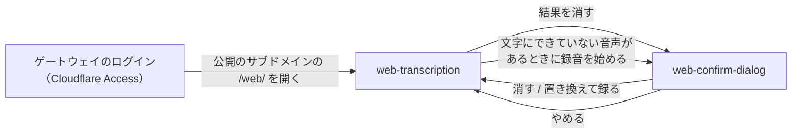

# 常駐アプリ

## 現状

<!-- table: data -->

| 分類 | ページ / ファイル | 概要 | 補足 |
| --- | --- | --- | --- |
| ドキュメント | [dev/設計書/シナリオ/単一ユースケース/録音を文字に起こす.yaml](https://github.com/shuhei1101/voice-paste/blob/develop/dev/%E8%A8%AD%E8%A8%88%E6%9B%B8/%E3%82%B7%E3%83%8A%E3%83%AA%E3%82%AA/%E5%8D%98%E4%B8%80%E3%83%A6%E3%83%BC%E3%82%B9%E3%82%B1%E3%83%BC%E3%82%B9/%E9%8C%B2%E9%9F%B3%E3%82%92%E6%96%87%E5%AD%97%E3%81%AB%E8%B5%B7%E3%81%93%E3%81%99.yaml) | セッションで確定した WAV の録音を起こして補正する | ブラウザの音声のキューからの入口と、WAV 以外の形式を足す |
| ドキュメント | [dev/設計書/シナリオ/単一ユースケース/常駐アプリを起動する.yaml](https://github.com/shuhei1101/voice-paste/blob/develop/dev/%E8%A8%AD%E8%A8%88%E6%9B%B8/%E3%82%B7%E3%83%8A%E3%83%AA%E3%82%AA/%E5%8D%98%E4%B8%80%E3%83%A6%E3%83%BC%E3%82%B9%E3%82%B1%E3%83%BC%E3%82%B9/%E5%B8%B8%E9%A7%90%E3%82%A2%E3%83%97%E3%83%AA%E3%82%92%E8%B5%B7%E5%8B%95%E3%81%99%E3%82%8B.yaml) | エンジン・API・ホットキーを立てる | ブラウザの音声のキューとワーカースレッドを立てる段を足す |
| ドキュメント | [dev/設計書/インターフェース定義/常駐アプリ/README.md](https://github.com/shuhei1101/voice-paste/blob/develop/dev/%E8%A8%AD%E8%A8%88%E6%9B%B8/%E3%82%A4%E3%83%B3%E3%82%BF%E3%83%BC%E3%83%95%E3%82%A7%E3%83%BC%E3%82%B9%E5%AE%9A%E7%BE%A9/%E5%B8%B8%E9%A7%90%E3%82%A2%E3%83%97%E3%83%AA/README.md) | `/sessions` の開始・停止・完了と返送 | `POST /web/transcriptions`・`GET /web/transcriptions/{job_id}`・`GET /web/` を足す |
| ドキュメント | [dev/設計書/画面設計/常駐アプリ/README.md](https://github.com/shuhei1101/voice-paste/blob/develop/dev/%E8%A8%AD%E8%A8%88%E6%9B%B8/%E7%94%BB%E9%9D%A2%E8%A8%AD%E8%A8%88/%E5%B8%B8%E9%A7%90%E3%82%A2%E3%83%97%E3%83%AA/README.md) | PySide6 の録音の画面・設定画面・トレイ | ブラウザの画面を足す |
| ドキュメント | [dev/設計書/モジュール構成/常駐アプリ/APIサーバー.py.yaml](https://github.com/shuhei1101/voice-paste/blob/develop/dev/%E8%A8%AD%E8%A8%88%E6%9B%B8/%E3%83%A2%E3%82%B8%E3%83%A5%E3%83%BC%E3%83%AB%E6%A7%8B%E6%88%90/%E5%B8%B8%E9%A7%90%E3%82%A2%E3%83%97%E3%83%AA/API%E3%82%B5%E3%83%BC%E3%83%90%E3%83%BC.py.yaml) | app の組み立て・要求の守り（Origin を断る・Host・トークン）・例外の変換 | 守りを `/web/` とそれ以外で分け、画面の配信と route を組み込む |
| ドキュメント | [dev/設計書/モジュール構成/常駐アプリ/文字起こし.py.yaml](https://github.com/shuhei1101/voice-paste/blob/develop/dev/%E8%A8%AD%E8%A8%88%E6%9B%B8/%E3%83%A2%E3%82%B8%E3%83%A5%E3%83%BC%E3%83%AB%E6%A7%8B%E6%88%90/%E5%B8%B8%E9%A7%90%E3%82%A2%E3%83%97%E3%83%AA/%E6%96%87%E5%AD%97%E8%B5%B7%E3%81%93%E3%81%97.py.yaml) | `transcribe`（エンジンで起こして区間を改行でつなぐ） | ブラウザの音声のジョブ・キュー・ワーカースレッドを足す |
| ドキュメント | [dev/設計書/モジュール構成/常駐アプリ/履歴.py.yaml](https://github.com/shuhei1101/voice-paste/blob/develop/dev/%E8%A8%AD%E8%A8%88%E6%9B%B8/%E3%83%A2%E3%82%B8%E3%83%A5%E3%83%BC%E3%83%AB%E6%A7%8B%E6%88%90/%E5%B8%B8%E9%A7%90%E3%82%A2%E3%83%97%E3%83%AA/%E5%B1%A5%E6%AD%B4.py.yaml) | `save_recording`（録音を WAV で書く）・`append_text` | 受けた音声を録れた形式のまま書く関数を足す |
| ドキュメント | [dev/設計書/モジュール構成/常駐アプリ/起動と配線.py.yaml](https://github.com/shuhei1101/voice-paste/blob/develop/dev/%E8%A8%AD%E8%A8%88%E6%9B%B8/%E3%83%A2%E3%82%B8%E3%83%A5%E3%83%BC%E3%83%AB%E6%A7%8B%E6%88%90/%E5%B8%B8%E9%A7%90%E3%82%A2%E3%83%97%E3%83%AA/%E8%B5%B7%E5%8B%95%E3%81%A8%E9%85%8D%E7%B7%9A.py.yaml) | main.py の配線と依存の向き | キューとワーカースレッドの配線と、新しい feature の依存の向きを足す |
| ドキュメント | [dev/設計書/モジュール構成/常駐アプリ/共通.py.yaml](https://github.com/shuhei1101/voice-paste/blob/develop/dev/%E8%A8%AD%E8%A8%88%E6%9B%B8/%E3%83%A2%E3%82%B8%E3%83%A5%E3%83%BC%E3%83%AB%E6%A7%8B%E6%88%90/%E5%B8%B8%E9%A7%90%E3%82%A2%E3%83%97%E3%83%AA/%E5%85%B1%E9%80%9A.py.yaml) | `Settings` などの設定のモデル | 許す Origin の一覧の設定を足す |
| ドキュメント | [dev/設計書/デザイン方針.md](https://github.com/shuhei1101/voice-paste/blob/develop/dev/%E8%A8%AD%E8%A8%88%E6%9B%B8/%E3%83%87%E3%82%B6%E3%82%A4%E3%83%B3%E6%96%B9%E9%87%9D.md) | 開発者ツールのスタイル。値の置き場所は `src/voice_paste/ui/tokens.toml`（QSS） | ブラウザの画面も同じスタイルで作り、CSS の値の置き場所を足す |
| 実装 | [src/voice_paste/server/middleware.py](https://github.com/shuhei1101/voice-paste/blob/develop/src/voice_paste/server/middleware.py) | Origin が付いた要求を全て 403 で断り、Host が `127.0.0.1`・`localhost` でなければ 403 で断る | `/web/` の下だけ Origin の許可リストで通す |
| 実装 | [src/voice_paste/server/app.py](https://github.com/shuhei1101/voice-paste/blob/develop/src/voice_paste/server/app.py) | セッションの route・例外ハンドラ・守りを組み込む | `/web/` の route と画面の配信を組み込む |
| 実装 | [src/voice_paste/server/error_handlers.py](https://github.com/shuhei1101/voice-paste/blob/develop/src/voice_paste/server/error_handlers.py) | 例外を problem+json に変換する | 404・413・415 の変換を足す |
| 実装 | [src/voice_paste/features/transcription/service.py](https://github.com/shuhei1101/voice-paste/blob/develop/src/voice_paste/features/transcription/service.py) | `transcribe` がエンジンを呼び、進みを `on_progress` で返す | ジョブのワーカースレッドから呼ぶ |
| 実装 | [src/voice_paste/integrations/whisper/client.py](https://github.com/shuhei1101/voice-paste/blob/develop/src/voice_paste/integrations/whisper/client.py) | ロックの中で 1 件ずつ子プロセスへ録音のパスを送る | 変えない（セッションとブラウザの音声はロックで順番に起こす） |
| 実装 | [src/voice_paste/features/history/service.py](https://github.com/shuhei1101/voice-paste/blob/develop/src/voice_paste/features/history/service.py) | 録音を WAV で書き、同じ名前の `.txt` に起こした文字を書く | 受けた音声を録れた形式の拡張子で書く |
| 実装 | [src/voice_paste/main.py](https://github.com/shuhei1101/voice-paste/blob/develop/src/voice_paste/main.py) | `_correct` が用語集と文頭・文末の文言で補正する | ジョブのワーカースレッドから同じ補正を呼ぶよう配線する |
| 実装 | [src/voice_paste/shared/settings.py](https://github.com/shuhei1101/voice-paste/blob/develop/src/voice_paste/shared/settings.py) | `ApiSettings`（`port`・`allowed_callback_hosts`） | 許す Origin の一覧を足す |
| 実装 | [pyproject.toml](https://github.com/shuhei1101/voice-paste/blob/develop/pyproject.toml) | 依存に python-multipart が無い | ライブラリ選定で決めた依存を足す |

<!-- /table -->

## 変更方針

<!-- table: data -->

| 対象 | 方針 | 補足 |
| --- | --- | --- |
| 画面の配信 | `GET /web/` で HTML・JS・CSS を返す。画面は 1 枚で、録る・ファイルを選ぶ・送る・結果を待つ・結果を残すを並べる | ファイルの置き場所はモジュール構成設計で決める |
| 受け付け | `POST /web/transcriptions` で multipart の `audio` を受け、一時のファイルに書いてキューに積み、`202 {"job_id"}` を返す | `job_id` は推測できない値（`secrets.token_urlsafe(16)`）にする。終わっていないジョブが待ちの上限（10 件）に達していれば 503 |
| 結果の取得 | `GET /web/transcriptions/{job_id}` で `state`・`progress`・`text`・`error` を返す | 終わったジョブは時間では捨てず、直近 100 件までメモリに持つ（超えた古い件と、起動し直した後は 404） |
| キューとワーカースレッド | 起動時にキューとワーカースレッドを 1 つ立て、1 件ずつ `transcribe` → 補正 → 履歴への書き込みを通す | 文字起こしワーカーはセッションとロックで順番に使う |
| 補正 | セッションと同じ用語集・文頭・文末の文言の削除を通す | - |
| 履歴 | 履歴を残す設定なら、受けた音声を録れた形式の拡張子のまま残し、同じ名前の `.txt` に起こした文字を書く。残さない設定なら起こした後に一時のファイルを消す | 古い履歴の削除が WAV 以外も消すことを確かめる |
| 形式 | 録れた形式（webm・ogg・mp4・MP3・WAV）のまま faster-whisper へ渡す | PyAV で読めない音声は 415 |
| 要求の守り | `/web/` の下は Origin が許可リストにある要求だけ通し、トークンを求めない。`/web/` の外は今の守り（Origin を断る・Host・トークン）のまま | ゲートウェイは Host を `localhost:{ポート}` に書き換えて渡すため、Host の守りは `/web/` の下も今のまま通る（`## PoC 結果`）。`/web/` の下の GET は Origin が無いか許可リストにあれば通し、POST は Origin が許可リストにあるときだけ通す（同一オリジンの GET には Origin が付かず、ほかのオリジンのページからの fetch には付くため） |
| 許す Origin | settings.toml に Origin の一覧のキーを足す | 既定の値はモジュール構成設計で決める |
| 上限 | 本文は 100,000,000 バイト未満、各要求は 66 秒以内に返す（ゲートウェイの 83 秒から安全率を引いた値） | 上限以上は 413。受け付けはキューに積んですぐ返すので、文字起こしの時間は応答に含めない。ゲートウェイの待ちには端末からのアップロードの時間が入り、本文の上限を 66 秒で送り切るには上り約 12 Mbps が要る。遅い回線で大きなファイルを選ぶとゲートウェイの 504 になり、画面は送信失敗を出して端末内の音声を残す |
| 端末の保存 | 送る前の音声は IndexedDB に直近 1 件、結果は localStorage に直近 10 件、どちらも保存日時を持ち、ページを開いたときに期限を過ぎた件を消す | 期限は保存日時から 7 日（`要件.md` の `## 要望`） |
| 画面の録音 | MediaRecorder の形式を `isTypeSupported` で webm/opus・mp4・ogg の順に選び、32kbps・上限 30 分で録り、残り時間を出す | Safari の AAC が 32kbps になるかを PoC で確かめる |
| エラー表示 | 送信の失敗は画面に出して送り直せるようにし、ジョブの `failed` は `error` を出す | - |
| エラー返却 | problem+json で 400（`audio` が無い）・403（Origin が許可リストに無い）・404（ジョブが無い）・413（大きすぎる）・415（読めない形式）・503（待ちが上限） | 今の API の `problem_response` に揃える |
| ログ | 受け付け・起こし終わり・失敗を、`job_id` と音声の大きさ・形式・秒数で 1 行ずつ出す | 起こした文字はログに出さない |
| レスポンシブ対応 | スマホ・iPad・PC の幅で崩れない 1 カラムにする | デザイン方針の開発者ツールのスタイルに揃える |
| 外部ライブラリ | multipart の本文を読むライブラリをライブラリ選定で決める | FastAPI の `UploadFile` は python-multipart を要る |
| セキュリティ | 認証は Cloudflare Access に任せ、常駐アプリは Origin の許可リストだけを見る | 待ち受けは 127.0.0.1 のまま |
| 既存機能への影響 | `/sessions` の守りと動きは変えない。ホットキーの録音中もブラウザの音声を受け付け、文字起こしワーカーは順番に使う | - |

<!-- /table -->

### 画面一覧

| 種別 | 画面 | 概要 | アクション | 判定の根拠 | 補足 |
| --- | --- | --- | --- | --- | --- |
| 新規 | `web-transcription` | 外の端末のブラウザで開く 1 枚（`GET /web/`）。上に送る区画（録る・ファイルを選ぶ・端末に残した直近 1 件の音声）、下に結果の一覧（直近 10 件）を 1 カラムで並べる | 録音開始<br>録音停止・送信<br>ファイル送信<br>再送信<br>ダウンロード<br>文字起こし待ち<br>コピー<br>削除 | 結果の一覧を見ながら次を録って送るため、送る区画と結果の一覧を同じ画面に並べる。選ぶ部品（録る・ファイルを選ぶ）は結果が出る場所より上に置く。コピー・消すは 1 件をすばやく扱う操作のため、結果の各件の中に置く。録音中の残り時間・送信中・待ちの進み具合・失敗は、同じ画面の中の表示の切り替えで出す | スマホ・iPad・PC の幅で同じ 1 カラムにする。マイクの許可はブラウザ標準の確認に任せる |
| 新規 | `web-confirm-dialog` | 取り消せない操作の確認（結果を 1 件消す・文字にできていない音声を新しい録音で置き換える） | 削除 / 置換して録音<br>キャンセル | 取り消せない操作の確認のため、モーダルにする | 案 A（確認ログ） |

| 案 | 内容 | メリット | デメリット |
| --- | --- | --- | --- |
| A | 結果を消すときと、文字にできていない音声があるのに録音を始めるときに、確認のモーダルを出す | 誤って押しても結果や音声を失わない。PC の画面の確認（`settings-reset-dialog` など）と揃う | 消す・録るたびに 1 回多く押す |
| B | 確かめずにその場で行い、「元に戻す」を数秒出す | 操作が 1 回で済む | 戻せる間だけ消した件と置き換えた音声を持つ仕組みが要る |
| C | 確かめずに行う | 仕組みが最も簡単 | 送りそびれた音声を新しい録音で失い、複合 UC の「録った直近 1 件の音声は端末に残る」を崩す |

推奨: A

端末に残る音声は直近 1 件だけで、置き換えると戻せない。
消す・置き換えるはどちらも頻繁な操作ではなく、1 回多く押す手間より失わないことを取る。

### 画面遷移



`web-confirm-dialog` は案 A で描いている（`### 画面一覧` の案）。

## PoC 結果

| 検証構成 | 成功条件 | 結果 | PoC PR | 補足 |
| --- | --- | --- | --- | --- |
| webm/opus（Edge の MediaRecorder、Cues とコンテナの長さなし） | `decode_audio` の長さが録った時間 ±0.1 秒・CER 5% 以下 | ✅ 差 0.024 秒・CER 0 | [#172](https://github.com/shuhei1101/voice-paste/pull/172)（closed） | 採用（録れた形式のまま渡す） |
| mp4 AAC（Edge の MediaRecorder、fragmented MP4） | 同上 | ✅ 差 0.024 秒・CER 0 | [#172](https://github.com/shuhei1101/voice-paste/pull/172)（closed） | `audioBitsPerSecond: 32000` を指定しても約 100kbps |
| fragmented MP4 AAC・ogg/opus・MP3（PyAV） | 元の WAV の長さ ±0.1 秒・CER 5% 以下 | ✅ 差 最大 0.044 秒・CER 0 | [#172](https://github.com/shuhei1101/voice-paste/pull/172)（closed） | - |
| 95MiB の multipart を `UploadFile` で一時ファイルへ写す | `202` が 83 秒以内・大きさが一致 | ✅ 0.41 秒・99,614,720 バイトで一致 | [#172](https://github.com/shuhei1101/voice-paste/pull/172)（closed） | python-multipart 0.0.32 を PoC の中だけで入れた |
| ゲートウェイ（`127.0.0.1:8700`）を通った GET と POST のヘッダー | 中継先に届く Host・Origin を記録できる | ✅ Host `localhost:{ポート}`・POST の Origin は公開のサブドメインのまま・GET は Origin なし・X-Forwarded-* なし | [#172](https://github.com/shuhei1101/voice-paste/pull/172)（closed） | 一時の登録（`gw add`、`--rewrite-origin` なし）で確かめて外した。Cloudflare は通していない |

結論: 成立。
ブラウザの MediaRecorder が書いた Cues の無い webm と fragmented MP4 も、WAV へ変換せずに今のワーカーで起こせる。
ゲートウェイを通った要求の Host は `localhost:47823` になるため、今の Host の守りは `/web/` の下もそのまま通る。
同一オリジンの GET（`GET /web/`・結果の取得）には Origin が付かず、Origin の許可リストで守れるのは POST だけになる。
tailscale serve はユーザーの判断でゲートウェイだけにしたため検証していない（[確認ログ](./確認ログ.md)）。
実機の Safari が録った mp4 は、fragmented MP4 を読めることまでを根拠にし、E2E の手動確認で確かめる。

最小再現コードの要点（[poc/check_formats.py](https://github.com/shuhei1101/voice-paste/blob/3164d10/poc/check_formats.py)・[poc/server.py](https://github.com/shuhei1101/voice-paste/blob/3164d10/poc/server.py)）:

```python
# 録れた形式のまま decode_audio へ渡し、今のワーカーで起こす
samples = decode_audio(str(path), sampling_rate=SAMPLE_RATE)
client = WhisperWorkerClient(settings=LocalWhisperSettings(), ready_timeout_sec=READY_TIMEOUT_SEC,
                             log_dir=OUT_DIR, stop_timeout_sec=STOP_TIMEOUT_SEC)
client.start(ready_timeout_sec=READY_TIMEOUT_SEC)
text = "\n".join(client.transcribe(path))

# multipart の audio を一時ファイルへ写して 202 を返す
@app.post("/upload", status_code=202)
def upload(audio: UploadFile) -> JSONResponse:
    with tempfile.NamedTemporaryFile(delete=False, dir=OUT_DIR, suffix=".upload") as temp:
        shutil.copyfileobj(audio.file, temp, COPY_CHUNK_BYTES)
        written = temp.tell()
    return JSONResponse({"size": written}, status_code=202)
```

diff の見どころ: Edge を `--use-fake-device-for-media-stream --use-file-for-fake-audio-capture` で起動して MediaRecorder で録るページ（`server.py` の `RECORD_PAGE`）と、記録（`poc/out/formats.json`・`poc/out/headers.jsonl`・`poc/out/upload.txt`）。

## テスト結果

### 単体

`tests/unit` の全 646 テストが pass（`.venv/Scripts/python.exe -m pytest tests/unit`）。

| ファイル | メソッド | 変更種別 | 結果 | 補足 |
| --- | --- | --- | --- | --- |
| [tests/unit/voice_paste/features/correction/test_service.py](https://github.com/shuhei1101/voice-paste/blob/develop/tests/unit/voice_paste/features/correction/test_service.py) | 全実行 | 実行のみ | ✅ | 40 テスト pass<br>`テスト結果/20261024012002_1ee6155_単体テスト.log` |
| [tests/unit/voice_paste/features/history/test_service.py](https://github.com/shuhei1101/voice-paste/blob/develop/tests/unit/voice_paste/features/history/test_service.py) | 全実行 | 変更 | ✅ | 13 テスト pass<br>`テスト結果/20261024012002_1ee6155_単体テスト.log` |
| [tests/unit/voice_paste/features/outputs/browser/test_service.py](https://github.com/shuhei1101/voice-paste/blob/develop/tests/unit/voice_paste/features/outputs/browser/test_service.py) | 全実行 | 実行のみ | ✅ | 3 テスト pass<br>`テスト結果/20261024012002_1ee6155_単体テスト.log` |
| [tests/unit/voice_paste/features/outputs/callback/test_service.py](https://github.com/shuhei1101/voice-paste/blob/develop/tests/unit/voice_paste/features/outputs/callback/test_service.py) | 全実行 | 実行のみ | ✅ | 14 テスト pass<br>`テスト結果/20261024012002_1ee6155_単体テスト.log` |
| [tests/unit/voice_paste/features/outputs/copy_only/test_service.py](https://github.com/shuhei1101/voice-paste/blob/develop/tests/unit/voice_paste/features/outputs/copy_only/test_service.py) | 全実行 | 実行のみ | ✅ | 3 テスト pass<br>`テスト結果/20261024012002_1ee6155_単体テスト.log` |
| [tests/unit/voice_paste/features/outputs/endpoint/test_service.py](https://github.com/shuhei1101/voice-paste/blob/develop/tests/unit/voice_paste/features/outputs/endpoint/test_service.py) | 全実行 | 実行のみ | ✅ | 4 テスト pass<br>`テスト結果/20261024012002_1ee6155_単体テスト.log` |
| [tests/unit/voice_paste/features/outputs/paste_and_send/test_service.py](https://github.com/shuhei1101/voice-paste/blob/develop/tests/unit/voice_paste/features/outputs/paste_and_send/test_service.py) | 全実行 | 実行のみ | ✅ | 8 テスト pass<br>`テスト結果/20261024012002_1ee6155_単体テスト.log` |
| [tests/unit/voice_paste/features/outputs/paste_only/test_service.py](https://github.com/shuhei1101/voice-paste/blob/develop/tests/unit/voice_paste/features/outputs/paste_only/test_service.py) | 全実行 | 実行のみ | ✅ | 3 テスト pass<br>`テスト結果/20261024012002_1ee6155_単体テスト.log` |
| [tests/unit/voice_paste/features/outputs/test_service.py](https://github.com/shuhei1101/voice-paste/blob/develop/tests/unit/voice_paste/features/outputs/test_service.py) | 全実行 | 実行のみ | ✅ | 5 テスト pass<br>`テスト結果/20261024012002_1ee6155_単体テスト.log` |
| [tests/unit/voice_paste/features/outputs/test_types.py](https://github.com/shuhei1101/voice-paste/blob/develop/tests/unit/voice_paste/features/outputs/test_types.py) | 全実行 | 実行のみ | ✅ | 3 テスト pass<br>`テスト結果/20261024012002_1ee6155_単体テスト.log` |
| [tests/unit/voice_paste/features/recording/test_client.py](https://github.com/shuhei1101/voice-paste/blob/develop/tests/unit/voice_paste/features/recording/test_client.py) | 全実行 | 実行のみ | ✅ | 1 テスト pass<br>`テスト結果/20261024012002_1ee6155_単体テスト.log` |
| [tests/unit/voice_paste/features/recording/test_segmenter.py](https://github.com/shuhei1101/voice-paste/blob/develop/tests/unit/voice_paste/features/recording/test_segmenter.py) | 全実行 | 実行のみ | ✅ | 12 テスト pass<br>`テスト結果/20261024012002_1ee6155_単体テスト.log` |
| [tests/unit/voice_paste/features/recording/test_service.py](https://github.com/shuhei1101/voice-paste/blob/develop/tests/unit/voice_paste/features/recording/test_service.py) | 全実行 | 実行のみ | ✅ | 22 テスト pass<br>`テスト結果/20261024012002_1ee6155_単体テスト.log` |
| [tests/unit/voice_paste/features/session/test_route.py](https://github.com/shuhei1101/voice-paste/blob/develop/tests/unit/voice_paste/features/session/test_route.py) | 全実行 | 実行のみ | ✅ | 3 テスト pass<br>`テスト結果/20261024012002_1ee6155_単体テスト.log` |
| [tests/unit/voice_paste/features/session/test_service.py](https://github.com/shuhei1101/voice-paste/blob/develop/tests/unit/voice_paste/features/session/test_service.py) | 全実行 | 実行のみ | ✅ | 56 テスト pass<br>`テスト結果/20261024012002_1ee6155_単体テスト.log` |
| [tests/unit/voice_paste/features/transcription/test_service.py](https://github.com/shuhei1101/voice-paste/blob/develop/tests/unit/voice_paste/features/transcription/test_service.py) | 全実行 | 実行のみ | ✅ | 6 テスト pass<br>`テスト結果/20261024012002_1ee6155_単体テスト.log` |
| `tests/unit/voice_paste/features/web_transcription/test_service.py` | 全実行 | 新規 | ✅ | 12 テスト pass<br>`テスト結果/20261024012002_1ee6155_単体テスト.log` |
| `tests/unit/voice_paste/integrations/audio/test_probe.py` | 全実行 | 新規 | ✅ | 7 テスト pass<br>`テスト結果/20261024012002_1ee6155_単体テスト.log` |
| [tests/unit/voice_paste/integrations/browser/test_opener.py](https://github.com/shuhei1101/voice-paste/blob/develop/tests/unit/voice_paste/integrations/browser/test_opener.py) | 全実行 | 実行のみ | ✅ | 4 テスト pass<br>`テスト結果/20261024012002_1ee6155_単体テスト.log` |
| [tests/unit/voice_paste/integrations/http/test_client.py](https://github.com/shuhei1101/voice-paste/blob/develop/tests/unit/voice_paste/integrations/http/test_client.py) | 全実行 | 実行のみ | ✅ | 7 テスト pass<br>`テスト結果/20261024012002_1ee6155_単体テスト.log` |
| [tests/unit/voice_paste/integrations/keyboard/test_sender.py](https://github.com/shuhei1101/voice-paste/blob/develop/tests/unit/voice_paste/integrations/keyboard/test_sender.py) | 全実行 | 実行のみ | ✅ | 9 テスト pass<br>`テスト結果/20261024012002_1ee6155_単体テスト.log` |
| [tests/unit/voice_paste/integrations/vad/test_adapter.py](https://github.com/shuhei1101/voice-paste/blob/develop/tests/unit/voice_paste/integrations/vad/test_adapter.py) | 全実行 | 実行のみ | ✅ | 5 テスト pass<br>`テスト結果/20261024012002_1ee6155_単体テスト.log` |
| [tests/unit/voice_paste/integrations/volume/test_adapter.py](https://github.com/shuhei1101/voice-paste/blob/develop/tests/unit/voice_paste/integrations/volume/test_adapter.py) | 全実行 | 実行のみ | ✅ | 9 テスト pass<br>`テスト結果/20261024012002_1ee6155_単体テスト.log` |
| [tests/unit/voice_paste/integrations/whisper/test_client.py](https://github.com/shuhei1101/voice-paste/blob/develop/tests/unit/voice_paste/integrations/whisper/test_client.py) | 全実行 | 実行のみ | ✅ | 14 テスト pass<br>`テスト結果/20261024012002_1ee6155_単体テスト.log` |
| [tests/unit/voice_paste/integrations/whisper/test_worker.py](https://github.com/shuhei1101/voice-paste/blob/develop/tests/unit/voice_paste/integrations/whisper/test_worker.py) | 全実行 | 実行のみ | ✅ | 7 テスト pass<br>`テスト結果/20261024012002_1ee6155_単体テスト.log` |
| [tests/unit/voice_paste/runtime/test_hotkey.py](https://github.com/shuhei1101/voice-paste/blob/develop/tests/unit/voice_paste/runtime/test_hotkey.py) | 全実行 | 実行のみ | ✅ | 8 テスト pass<br>`テスト結果/20261024012002_1ee6155_単体テスト.log` |
| [tests/unit/voice_paste/runtime/test_process.py](https://github.com/shuhei1101/voice-paste/blob/develop/tests/unit/voice_paste/runtime/test_process.py) | 全実行 | 実行のみ | ✅ | 2 テスト pass<br>`テスト結果/20261024012002_1ee6155_単体テスト.log` |
| [tests/unit/voice_paste/runtime/test_settings_store.py](https://github.com/shuhei1101/voice-paste/blob/develop/tests/unit/voice_paste/runtime/test_settings_store.py) | 全実行 | 実行のみ | ✅ | 1 テスト pass<br>`テスト結果/20261024012002_1ee6155_単体テスト.log` |
| [tests/unit/voice_paste/runtime/test_single_instance.py](https://github.com/shuhei1101/voice-paste/blob/develop/tests/unit/voice_paste/runtime/test_single_instance.py) | 全実行 | 実行のみ | ✅ | 10 テスト pass<br>`テスト結果/20261024012002_1ee6155_単体テスト.log` |
| [tests/unit/voice_paste/runtime/test_timer.py](https://github.com/shuhei1101/voice-paste/blob/develop/tests/unit/voice_paste/runtime/test_timer.py) | 全実行 | 実行のみ | ✅ | 3 テスト pass<br>`テスト結果/20261024012002_1ee6155_単体テスト.log` |
| [tests/unit/voice_paste/server/test_app.py](https://github.com/shuhei1101/voice-paste/blob/develop/tests/unit/voice_paste/server/test_app.py) | 全実行 | 実行のみ | ✅ | 3 テスト pass<br>`テスト結果/20261024012002_1ee6155_単体テスト.log` |
| `tests/unit/voice_paste/server/test_body_limit.py` | 全実行 | 新規 | ✅ | 5 テスト pass<br>`テスト結果/20261024012002_1ee6155_単体テスト.log` |
| [tests/unit/voice_paste/server/test_error_handlers.py](https://github.com/shuhei1101/voice-paste/blob/develop/tests/unit/voice_paste/server/test_error_handlers.py) | 全実行 | 変更 | ✅ | 7 テスト pass<br>`テスト結果/20261024012002_1ee6155_単体テスト.log` |
| [tests/unit/voice_paste/server/test_middleware.py](https://github.com/shuhei1101/voice-paste/blob/develop/tests/unit/voice_paste/server/test_middleware.py) | 全実行 | 変更 | ✅ | 10 テスト pass<br>`テスト結果/20261024012002_1ee6155_単体テスト.log` |
| [tests/unit/voice_paste/server/test_runner.py](https://github.com/shuhei1101/voice-paste/blob/develop/tests/unit/voice_paste/server/test_runner.py) | 全実行 | 実行のみ | ✅ | 4 テスト pass<br>`テスト結果/20261024012002_1ee6155_単体テスト.log` |
| [tests/unit/voice_paste/server/test_token.py](https://github.com/shuhei1101/voice-paste/blob/develop/tests/unit/voice_paste/server/test_token.py) | 全実行 | 実行のみ | ✅ | 3 テスト pass<br>`テスト結果/20261024012002_1ee6155_単体テスト.log` |
| `tests/unit/voice_paste/server/test_web_page.py` | 全実行 | 新規 | ✅ | 2 テスト pass<br>`テスト結果/20261024012002_1ee6155_単体テスト.log` |
| [tests/unit/voice_paste/shared/test_constants.py](https://github.com/shuhei1101/voice-paste/blob/develop/tests/unit/voice_paste/shared/test_constants.py) | 全実行 | 実行のみ | ✅ | 2 テスト pass<br>`テスト結果/20261024012002_1ee6155_単体テスト.log` |
| [tests/unit/voice_paste/shared/test_logger.py](https://github.com/shuhei1101/voice-paste/blob/develop/tests/unit/voice_paste/shared/test_logger.py) | 全実行 | 実行のみ | ✅ | 6 テスト pass<br>`テスト結果/20261024012002_1ee6155_単体テスト.log` |
| [tests/unit/voice_paste/shared/test_settings.py](https://github.com/shuhei1101/voice-paste/blob/develop/tests/unit/voice_paste/shared/test_settings.py) | 全実行 | 実行のみ | ✅ | 66 テスト pass<br>`テスト結果/20261024012002_1ee6155_単体テスト.log` |
| [tests/unit/voice_paste/test_main.py](https://github.com/shuhei1101/voice-paste/blob/develop/tests/unit/voice_paste/test_main.py) | 全実行 | 変更 | ✅ | 35 テスト pass<br>`テスト結果/20261024012002_1ee6155_単体テスト.log` |
| [tests/unit/voice_paste/ui/test_bridge.py](https://github.com/shuhei1101/voice-paste/blob/develop/tests/unit/voice_paste/ui/test_bridge.py) | 全実行 | 実行のみ | ✅ | 4 テスト pass<br>`テスト結果/20261024012002_1ee6155_単体テスト.log` |
| [tests/unit/voice_paste/ui/test_controller.py](https://github.com/shuhei1101/voice-paste/blob/develop/tests/unit/voice_paste/ui/test_controller.py) | 全実行 | 実行のみ | ✅ | 26 テスト pass<br>`テスト結果/20261024012002_1ee6155_単体テスト.log` |
| [tests/unit/voice_paste/ui/test_placement.py](https://github.com/shuhei1101/voice-paste/blob/develop/tests/unit/voice_paste/ui/test_placement.py) | 全実行 | 実行のみ | ✅ | 2 テスト pass<br>`テスト結果/20261024012002_1ee6155_単体テスト.log` |
| [tests/unit/voice_paste/ui/test_style.py](https://github.com/shuhei1101/voice-paste/blob/develop/tests/unit/voice_paste/ui/test_style.py) | 全実行 | 実行のみ | ✅ | 27 テスト pass<br>`テスト結果/20261024012002_1ee6155_単体テスト.log` |
| [tests/unit/voice_paste/ui/test_tray.py](https://github.com/shuhei1101/voice-paste/blob/develop/tests/unit/voice_paste/ui/test_tray.py) | 全実行 | 実行のみ | ✅ | 13 テスト pass<br>`テスト結果/20261024012002_1ee6155_単体テスト.log` |
| [tests/unit/voice_paste/ui/windows/test_settings_edge_phrases.py](https://github.com/shuhei1101/voice-paste/blob/develop/tests/unit/voice_paste/ui/windows/test_settings_edge_phrases.py) | 全実行 | 実行のみ | ✅ | 8 テスト pass<br>`テスト結果/20261024012002_1ee6155_単体テスト.log` |
| [tests/unit/voice_paste/ui/windows/test_settings_glossaries.py](https://github.com/shuhei1101/voice-paste/blob/develop/tests/unit/voice_paste/ui/windows/test_settings_glossaries.py) | 全実行 | 実行のみ | ✅ | 17 テスト pass<br>`テスト結果/20261024012002_1ee6155_単体テスト.log` |
| [tests/unit/voice_paste/ui/windows/test_settings_hints.py](https://github.com/shuhei1101/voice-paste/blob/develop/tests/unit/voice_paste/ui/windows/test_settings_hints.py) | 全実行 | 実行のみ | ✅ | 12 テスト pass<br>`テスト結果/20261024012002_1ee6155_単体テスト.log` |
| [tests/unit/voice_paste/ui/windows/test_settings_presets.py](https://github.com/shuhei1101/voice-paste/blob/develop/tests/unit/voice_paste/ui/windows/test_settings_presets.py) | 全実行 | 実行のみ | ✅ | 11 テスト pass<br>`テスト結果/20261024012002_1ee6155_単体テスト.log` |
| [tests/unit/voice_paste/ui/windows/test_settings_window.py](https://github.com/shuhei1101/voice-paste/blob/develop/tests/unit/voice_paste/ui/windows/test_settings_window.py) | 全実行 | 実行のみ | ✅ | 37 テスト pass<br>`テスト結果/20261024012002_1ee6155_単体テスト.log` |
| [tests/unit/voice_paste/ui/windows/test_transcribing_indicator.py](https://github.com/shuhei1101/voice-paste/blob/develop/tests/unit/voice_paste/ui/windows/test_transcribing_indicator.py) | 全実行 | 実行のみ | ✅ | 52 テスト pass<br>`テスト結果/20261024012002_1ee6155_単体テスト.log` |

lint: `uv.exe lock --check` と `.venv/Scripts/lint-imports.exe` に違反なし（`テスト結果/20261024012002_1ee6155_lint.log`）。

### 結合

なし
