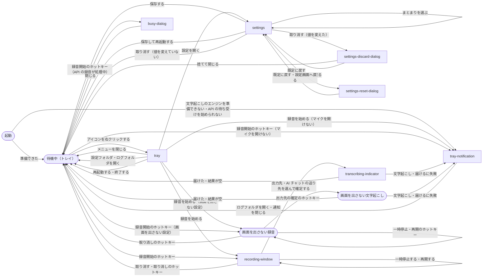

# 常駐アプリ

## 現状

| 分類 | ページ / ファイル | 概要 | 補足 |
| --- | --- | --- | --- |
| ドキュメント | [dev/設計書/モジュール構成/常駐アプリ/ホットキーと画面.py.yaml](https://github.com/shuhei1101/voice-paste/blob/develop/dev/%E8%A8%AD%E8%A8%88%E6%9B%B8/%E3%83%A2%E3%82%B8%E3%83%A5%E3%83%BC%E3%83%AB%E6%A7%8B%E6%88%90/%E5%B8%B8%E9%A7%90%E3%82%A2%E3%83%97%E3%83%AA/%E3%83%9B%E3%83%83%E3%83%88%E3%82%AD%E3%83%BC%E3%81%A8%E7%94%BB%E9%9D%A2.py.yaml) | `HotkeyListener`・`UiBridge`・`notify` の境界だけが `status: planned`。画面の構成・部品は #21 で起こすとしてある | 更新対象。トレイ・録音の画面・文字起こし中の表示・設定画面・ダイアログのクラスが無い |
| ドキュメント | [dev/設計書/モジュール構成/常駐アプリ/起動と配線.py.yaml](https://github.com/shuhei1101/voice-paste/blob/develop/dev/%E8%A8%AD%E8%A8%88%E6%9B%B8/%E3%83%A2%E3%82%B8%E3%83%A5%E3%83%BC%E3%83%AB%E6%A7%8B%E6%88%90/%E5%B8%B8%E9%A7%90%E3%82%A2%E3%83%97%E3%83%AA/%E8%B5%B7%E5%8B%95%E3%81%A8%E9%85%8D%E7%B7%9A.py.yaml) | `main` は API サーバーを立てて終了の合図を待つ。知らせは `log_notify` でログへ書くだけ。`start_local_session` が `status: planned` | 更新対象。Qt のイベントループ・トレイ・ホットキーの受付の配線と、知らせを `notify` へ替える |
| ドキュメント | [dev/設計書/モジュール構成/常駐アプリ/セッション.py.yaml](https://github.com/shuhei1101/voice-paste/blob/develop/dev/%E8%A8%AD%E8%A8%88%E6%9B%B8/%E3%83%A2%E3%82%B8%E3%83%A5%E3%83%BC%E3%83%AB%E6%A7%8B%E6%88%90/%E5%B8%B8%E9%A7%90%E3%82%A2%E3%83%97%E3%83%AA/%E3%82%BB%E3%83%83%E3%82%B7%E3%83%A7%E3%83%B3.py.yaml) | ホットキー・トレイからの開始・一時停止・再開・確定（出力先と AI チャットの送り先）・取り消しのメソッドと `NotifyFn` は実装済み | 画面が要る値（経過時間・音量・文字起こしの経過）の渡し方によっては更新対象 |
| ドキュメント | [dev/設計書/設定/常駐アプリ.yaml](https://github.com/shuhei1101/voice-paste/blob/develop/dev/%E8%A8%AD%E8%A8%88%E6%9B%B8/%E8%A8%AD%E5%AE%9A/%E5%B8%B8%E9%A7%90%E3%82%A2%E3%83%97%E3%83%AA.yaml) | `hotkeys.*`・`outputs[]`・`ui.*`（`topmost`・`position`・`follow_cursor`・`wave_gain`）・`recording.hide_window` ほか、各キーに反映（`immediate` / `restart`）がある | 設定画面の欄の元。画面の設計で項目の過不足が出れば更新対象 |
| ドキュメント | [dev/設計書/外部ライブラリ/pyside6-essentials.yaml](https://github.com/shuhei1101/voice-paste/blob/develop/dev/%E8%A8%AD%E8%A8%88%E6%9B%B8/%E5%A4%96%E9%83%A8%E3%83%A9%E3%82%A4%E3%83%96%E3%83%A9%E3%83%AA/pyside6-essentials.yaml)・[dev/設計書/外部ライブラリ/pynput.yaml](https://github.com/shuhei1101/voice-paste/blob/develop/dev/%E8%A8%AD%E8%A8%88%E6%9B%B8/%E5%A4%96%E9%83%A8%E3%83%A9%E3%82%A4%E3%83%96%E3%83%A9%E3%83%AA/pynput.yaml) | pyside6-essentials の版の固定の仕方が「未定（#21 で決める）」 | 更新対象 |
| ドキュメント | [dev/設計書/テスト/テスト実行方法.yaml](https://github.com/shuhei1101/voice-paste/blob/develop/dev/%E8%A8%AD%E8%A8%88%E6%9B%B8/%E3%83%86%E3%82%B9%E3%83%88/%E3%83%86%E3%82%B9%E3%83%88%E5%AE%9F%E8%A1%8C%E6%96%B9%E6%B3%95.yaml) | E2E は API の複合ユースケースだけ | 画面とホットキーの E2E・画面の結合テストを流す前提によっては更新対象 |
| 実装 | [src/voice_paste/ui/](https://github.com/shuhei1101/voice-paste/blob/develop/src/voice_paste/ui/) | `__init__.py` だけ | 新規 |
| 実装 | [src/voice_paste/main.py](https://github.com/shuhei1101/voice-paste/blob/develop/src/voice_paste/main.py) | API サーバーを立てて Ctrl+C・Ctrl+Break を待つ。知らせはログだけ | 変更 |
| 実装 | [pyproject.toml](https://github.com/shuhei1101/voice-paste/blob/develop/pyproject.toml) | pynput は入っているが PySide6 が無い | 変更 |
| 実装 | [resources/icon.ico](https://github.com/shuhei1101/voice-paste/blob/develop/resources/icon.ico) | exe のアイコン。トレイは今コードで描いている | トレイのアイコンの画像の元にするかは画面の設計で決める |
| 実装 | [voice_paste_legacy/gui.py](https://github.com/shuhei1101/voice-paste/blob/develop/voice_paste_legacy/gui.py)・[voice_paste_legacy/settings_gui.py](https://github.com/shuhei1101/voice-paste/blob/develop/voice_paste_legacy/settings_gui.py)・[voice_paste_legacy/tray.py](https://github.com/shuhei1101/voice-paste/blob/develop/voice_paste_legacy/tray.py) | 今の録音の画面・文字起こし中の表示・設定画面・トレイ（tkinter・pystray） | 機能を合わせる元。変えない |

## 変更方針

| 対象 | 方針 | 補足 |
| --- | --- | --- |
| 画面の構成と見た目 | デザインスタイル選定・画面一覧・画面遷移・モック作成を designer に依頼し、ユーザーが合意したモックを画面設計に起こす。色・フォントは QSS にまとめ、部品ごとに直書きしない | 方針の記録のリスク（色・フォントの直書き） |
| 画面の対象 | 録音の画面・文字起こし中の表示・設定画面・トレイのメニュー・ダイアログ（処理中に開始が来た・起動に失敗した・マイクを開けない・文字起こしに失敗・届けられない・API の待ち受けに失敗） | `NotifyFn` の知らせの種類ごとに、どの画面・ダイアログで知らせるかを画面設計で決める |
| 最前面 | 録音の画面は `Qt.WindowStaysOnTopHint` で出し、「常に手前に表示」でないほかのウィンドウが前面に出ても上に残す（[#4](https://github.com/shuhei1101/voice-paste/issues/4)）。ほかの「常に手前に表示」のウィンドウより上へ出し直す手当てはしない。カーソルのあるモニターへの表示は PySide6 の画面の判定に任せる | PoC の結果と確認ログの決着 |
| 終わり方 | Qt のイベントループの中で Python のシグナルのハンドラが動くよう、空の定期のタイマー（200 ms）を置き、Ctrl+Break（SIGBREAK）・Ctrl+C でイベントループを抜ける。抜けたら API サーバーとホットキーのスレッドを止めて待つ | PoC で、定期のタイマーが無いと Ctrl+Break で終わらないと分かった |
| 設定画面 | 欄を `Settings` のモデルから組み立て、項目を足しても画面の直しが増えないようにする。保存はモデルで確かめてから tomlkit で書き、確かめに通らない欄はその場で示す。反映が `restart` の項目はそれと分かるように出す | 方針の記録のリスク（値を確かめずに書く・4 か所の直し） |
| 設定の反映 | 保存した値のうち反映が `immediate` のもの（出力先のオン・オフ・ホットキー・`ui.*` を含む）を動いている常駐アプリに効かせる。ホットキーは受付を張り直す | [#34](https://github.com/shuhei1101/voice-paste/pull/34) から持ち越した出力先のオン・オフの反映 |
| ホットキー | `runtime/hotkey.py` の `HotkeyListener` が pynput で設定のホットキーを受け付け、配線された関数を呼ぶ。セッションは import しない | - |
| スレッド | 画面の部品はメインスレッド（Qt のイベントループ）だけが触り、API・ホットキー・ワーカーのスレッドからは `UiBridge` の Signal で渡す | PySide6 のイベントループと pynput・uvicorn のスレッドの受け渡しを PoC で確かめる（方針の記録のリスクで PoC で確かめるとした） |
| 配線 | `main.py` が Qt のアプリケーション・トレイ・`HotkeyListener` を立て、`notify` をセッションへ渡し、`start_local_session` をホットキー・トレイの開始へつなぐ。終了は Qt のイベントループの終わりで API サーバー・タイマー・エンジンを止める | 起動の失敗（エンジンを準備できない・API の待ち受けに失敗）はトレイで知らせてログに残す |
| トレイのアイコン | アイコンの画像を `resources/` に同梱し、待機中・録音中などの状態ごとに PySide6 のトレイで出し分ける | 方針の記録のリスク（アイコンが同梱されていない） |
| 依存 | `pyside6-essentials` を `pyproject.toml` に版を決めて書き、外部ライブラリの設計書の版の固定の仕方を埋める | - |
| 依存の向き | `ui`・`runtime` は `features` の中を直に import せず、`main.py` が配線する。import-linter の契約に `ui`・`runtime` を足す | - |
| テスト | 画面は画面設計を元に結合テスト（pytest-qt 等で部品を操作し、差し替えたセッションのメソッドが呼ばれること）で確かめ、`HotkeyListener`・`UiBridge` は単体テストで確かめる。ホットキーで録って貼り付ける流れと最前面は実機の E2E で確かめる | テストの道具の採否は設計で決める。PoC はモニター 1 枚でしか測れておらず、複数のモニター・拡大率の違うモニターでの表示位置は実機の E2E で確かめる |

### 画面一覧

| 種別 | 画面 | 概要 | アクション | 判定の根拠 | 補足 |
| --- | --- | --- | --- | --- | --- |
| 新規 | `recording-window` | 録音の画面。状態（録音中・一時停止中）・経過時間・波形と、確定の操作を 1 つの小さな窓に並べる | 一時停止する<br>再開する<br>取り消す<br>出力先を選んで確定する（貼り付けて送信・貼り付けのみ・コピー）<br>AI チャットの送り先を選んで確定する | 話しながら経過と波形を見て、そのまま確定先を選ぶため、同じ画面に並べる | 設定でオンにした出力先と、出すとした AI チャットの送り先だけを出す。各操作の横にホットキーを出し、同じ操作はホットキーでも行える。録音の画面を出さない設定（`recording.hide_window`）と API から始めた録音では開かない |
| 新規 | `transcribing-indicator` | 文字起こし中の表示。経過と残りの時間・貼り付けたい場所にカーソルを合わせる案内 | なし | 確定の後に裏で進む処理の経過を示すだけで、操作を持たないため、録音の画面と分けて小さな表示にする | フォーカスを取らない（貼り付け先の入力欄からフォーカスを奪わない）。録音の画面を出さない設定と API から始めた録音では開かない |
| 新規 | `tray` | トレイのアイコンとメニュー。アイコンは準備中・待機中・録音中・文字起こし中・失敗で出し分ける | 録音を始める（アイコンの既定の操作）<br>設定を開く<br>設定フォルダを開く<br>ログフォルダを開く<br>再起動する<br>終了する | 常駐アプリの入口で、画面を持たない間の操作をまとめるため、トレイのメニューにする | 録音から届けるまでの間（API から始めた録音の間を含む）は「録音を始める」と「設定…」を押せなくし、項目名に「（録音中）」と理由を出す。「録音を始める」の後の流れは録音開始のホットキーと同じで、録音の画面を出さない設定ではトレイから始めても画面を出さない |
| 新規 | `tray-notification` | トレイの通知。裏で起きた失敗を知らせる（マイクを開けない・文字起こしに失敗・届けられない・API の待ち受けに失敗・文字起こしのエンジンを準備できない） | ログフォルダを開く | 利用者が操作していない間に裏の処理で起きた知らせのため、モーダルにせず通知にする | 通知は Windows の通知センターに残り、後から見返せる。文字起こしに失敗・届けられないの 2 つは `未確定`（決める段: モック作成） |
| 新規 | `busy-dialog` | 処理中のため録音を始められないことを知らせるダイアログ | 閉じる | 利用者が録音開始のホットキーを押した操作に対する応答で、押した操作が効かなかった理由を確実に伝えるため、モーダルにする | API から始めた録音が録音中のときにだけ出る |
| 新規 | `settings` | 設定画面。`settings.toml` の全てのキーを、まとまり（出力先・ホットキー・録音・文字起こし・画面・履歴とログ・API）ごとに欄で並べる | まとまりを選ぶ<br>欄の値を変える<br>ホットキーの欄でキーの組み合わせを押して入れる<br>AI チャットの送り先を足す・消す<br>用語集のファイルを選ぶ<br>保存する<br>保存して再起動する<br>既定に戻す<br>取り消す（キャンセル・Esc） | まとまりが 7 つで 5 つを超えるため、まとまりは横のメニューで切り替える。入力が区画に分かれるため、トレイから開く別の画面にする | 欄は設定のモデルから組み立てる。反映が `restart` の欄に「再起動で反映」を出し、そうした欄を変えたときだけ「保存して再起動」を出す。確かめに通らない欄は、その欄の下にエラーを出し、最初のエラーの欄へフォーカスを移す。AI チャットの送り先は、送り先の一覧の行の中で足す・消す |
| 新規 | `settings-discard-dialog` | 変えた値を捨てて閉じるかの確認 | 捨てて閉じる<br>設定画面へ戻る | 入力した内容が消える閉じ方のため、確認を挟む | 欄を変えたまま取り消す・窓を閉じたときにだけ出る |
| 新規 | `settings-reset-dialog` | 全ての設定を既定の値へ戻すかの確認 | 既定に戻す<br>設定画面へ戻る | 取り消せない操作の確認のため、モーダルにする | 戻した後の値は、ほかの保存と同じく反映の種類に従って効く |

知らせの種類（`NotifyFn`）ごとの出し方は次のとおり。

| 知らせ | 出し方 |
| --- | --- |
| `state_changed` | トレイのアイコンを状態に合わせて替え、録音の画面・文字起こし中の表示を開く・閉じる |
| `busy` | `busy-dialog` |
| `microphone_unavailable` | `tray-notification` |
| `transcription_failed` | `tray-notification`（`未確定`） |
| `delivery_failed` | `tray-notification`（`未確定`） |
| `api_unavailable` | `tray-notification` |

文字起こしのエンジンを準備できないときは、トレイのアイコンを失敗にして `tray-notification` で知らせる。

文字起こしに失敗・届けられないの知らせ方（`未確定`、決める段: モック作成）

| 案 | 内容 | メリット | デメリット |
| --- | --- | --- | --- |
| A | トレイの通知で知らせる | 確定の後に別のアプリで作業していても手を止めさせない。通知センターに残り、後から見返せる | 通知を切っている・集中モードのときは気づきにくい |
| B | ダイアログで知らせる | 話した内容が届かなかったことに確実に気づく | 利用者が操作していない時点で前面に出て、作業中のアプリの入力を遮る |

推奨: A

確定した後、利用者は貼り付け先のアプリで作業を続けている。
裏の処理の知らせは通知で出し（外部規約『画面の分け方』の `## モーダル`）、録音と起こした文字は履歴に残っていて取り返せる。

### 画面遷移



`起動` は常駐アプリを起動してから待機中になるまでで、トレイのアイコンは準備中を示す。
`待機中（トレイ）` はどの画面も開いていない状態で、トレイのアイコンだけが出ている。
`画面を出さない録音`・`画面を出さない文字起こし` は、録音の画面を出さない設定でホットキーから始めた録音で、トレイのアイコンだけが状態を示す。
API から始めた録音は画面を開かず、どの画面へも移らない（失敗は呼び出し元へ返す）。

## PoC 結果

Windows の実機（拡大率 150% のモニター 1 枚）で、pyside6-essentials 6.11.2・pynput 1.8.2・fastapi 0.142.2・uvicorn 0.54.0 を使って測った。

| 検証構成 | 成功条件 | 結果 | PoC PR | 補足 |
| --- | --- | --- | --- | --- |
| ホットキーのスレッドからの知らせ | 100 回ともメインスレッドのスロットで動く | ✅ 100/100 | [#39](https://github.com/shuhei1101/voice-paste/pull/39) | 遅れの最大 1.4 ms。ドライバーが合成したキーで押した（`GlobalHotKeys` は合成したキーを無視するため、同じリスナーのスレッドで `HotKey` を回した） |
| API のスレッドからの知らせ | 100 回ともメインスレッドで動き、応答が全て 200 | ✅ 100/100 | [#39](https://github.com/shuhei1101/voice-paste/pull/39) | 遅れの最大 0.3 ms |
| 画面が固まらない | 遅れの最大 100 ms 以内、100 ms ごとのタイマーの発火の間隔の最大 200 ms 以内 | ✅ 123 ms | [#39](https://github.com/shuhei1101/voice-paste/pull/39) | ホットキー・API の 100 回の間の発火の間隔の最大 |
| 終わり方（トレイ） | 5 秒以内にスレッドが終わり、終了コード 0 | ✅ 0.2 秒 | [#39](https://github.com/shuhei1101/voice-paste/pull/39) | 3 回とも |
| 終わり方（Ctrl+Break） | 5 秒以内にスレッドが終わり、終了コード 0 | ✅ 0.3 秒（定期のタイマーあり）<br>❌ 30 秒で kill（定期のタイマーなし） | [#39](https://github.com/shuhei1101/voice-paste/pull/39) | Qt のイベントループの中では Python のシグナルのハンドラが動かない。200 ms ごとの空のタイマーを置くと 3 回とも 0.3 秒で終わる |
| 最前面を保つ（ほかの最前面のウィンドウ） | 前面へ出した後も録音の画面が上 | ❌ 0/10（手当てなし）<br>✅ 10/10 が 112 ms 以内に上へ戻る（手当てあり） | [#39](https://github.com/shuhei1101/voice-paste/pull/39) | 手当ては 100 ms ごとに `SetWindowPos(HWND_TOPMOST, SWP_NOACTIVATE)` で出し直す。同じく最前面を取り直すアプリと並ぶと 3 秒で 54 回上下が入れ替わる |
| 最前面を保つ（出し直し） | 隠して出し直すと録音の画面が上 | ✅ 10/10 | [#39](https://github.com/shuhei1101/voice-paste/pull/39) | ほかの最前面のウィンドウより上に出る |
| 貼り付け先へ届く（ホットキーで確定） | 10 回ともメモ帳に文字が入る | ✅ 10/10 | [#39](https://github.com/shuhei1101/voice-paste/pull/39) | メモ帳の代わりに別プロセスの入力欄（中身をファイルへ書く）を貼り付け先にした。録音の画面を出しても前面は貼り付け先のまま |
| 貼り付け先へ届く（画面のボタンで確定） | 10 回ともメモ帳に文字が入る | ✅ 10/10 | [#39](https://github.com/shuhei1101/voice-paste/pull/39) | ボタンを押すと録音の画面が前面になるが、画面を隠すと前面が貼り付け先へ戻る。フォーカスを取らない指定は使っていない |
| カーソルのあるモニター | `screenAt(QCursor.pos())` の作業領域の中に出る | ✅ 1/1 | [#39](https://github.com/shuhei1101/voice-paste/pull/39) | モニターが 1 枚のため、複数のモニター・拡大率の違うモニターは測れていない。Win32 の `MonitorFromWindow` でも同じモニター |
| トレイ | `isSystemTrayAvailable()` が True で、アイコンとメニューが出る | ✅ | [#39](https://github.com/shuhei1101/voice-paste/pull/39) | - |

スレッドの受け渡し・終わり方・貼り付け先へ届くことは成立した。
Ctrl+Break で終わるには、Qt のイベントループの中で Python へ戻る定期のタイマーが要る。
最前面は、後から前面へ出たほかの最前面のウィンドウに手当てなしでは負ける。
要件を「常に手前に表示」でないウィンドウより上に絞り、手当てはしないと決まった（確認ログ）ため、成立とする。

```python
class UiBridge(QObject):
    notified = Signal(str, float)
    command = Signal(object)

# ほかのスレッドからは emit だけ。メインスレッドのスロットへ QueuedConnection で渡る
bridge.notified.connect(on_notified, Qt.ConnectionType.QueuedConnection)
bridge.command.connect(lambda fn: fn(), Qt.ConnectionType.QueuedConnection)

# Ctrl+Break を受けるため、イベントループから定期的に Python へ戻す
wake_timer = QTimer()
wake_timer.timeout.connect(lambda: None)
wake_timer.start(200)
signal.signal(signal.SIGBREAK, lambda *_: app.quit())

# 終わるときに API とホットキーのスレッドを止めて待つ
app.aboutToQuit.connect(stop_threads)  # server.should_exit = True・listener.stop()・join

# 前面を保つ手当て（フォーカスは取らない）
keep_top_timer.timeout.connect(
    lambda: SetWindowPos(hwnd, HWND_TOPMOST, 0, 0, 0, 0, SWP_NOMOVE | SWP_NOSIZE | SWP_NOACTIVATE)
)
```

PoC PR の diff の見どころは `poc/qt_threads.py` の `Poc._start_hotkeys`・`Poc.on_about_to_quit`・`Driver.check_topmost` と、`poc/results/` の計測の結果。