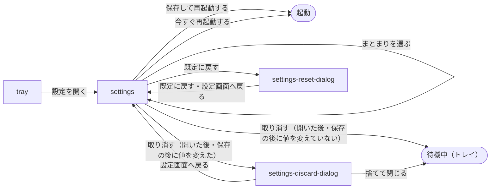

# 常駐アプリ

## 現状

| 分類 | ページ / ファイル | 概要 | 補足 |
| --- | --- | --- | --- |
| ドキュメント | [設計書/シナリオ/単一ユースケース/設定を変える.yaml](https://github.com/shuhei1101/voice-paste/blob/develop/dev/%E8%A8%AD%E8%A8%88%E6%9B%B8/%E3%82%B7%E3%83%8A%E3%83%AA%E3%82%AA/%E5%8D%98%E4%B8%80%E3%83%A6%E3%83%BC%E3%82%B9%E3%82%B1%E3%83%BC%E3%82%B9/%E8%A8%AD%E5%AE%9A%E3%82%92%E5%A4%89%E3%81%88%E3%82%8B.yaml) | 設定画面で設定を変えて保存する | 「保存」を押す正常シナリオのフローの「閉じる」と期待値の「設定画面が閉じている」を、開いたまま保存できたことを出すへ書き換える |
| ドキュメント | [設計書/画面設計/常駐アプリ/設定画面.py.yaml](https://github.com/shuhei1101/voice-paste/blob/develop/dev/%E8%A8%AD%E8%A8%88%E6%9B%B8/%E7%94%BB%E9%9D%A2%E8%A8%AD%E8%A8%88/%E5%B8%B8%E9%A7%90%E3%82%A2%E3%83%97%E3%83%AA/%E8%A8%AD%E5%AE%9A%E7%94%BB%E9%9D%A2.py.yaml) | 設定画面の要素 | 保存ボタンの description・action を閉じないものへ変え、保存できたことを出す要素を足す |
| ドキュメント | [設計書/モジュール構成/常駐アプリ/ホットキーと画面.py.yaml](https://github.com/shuhei1101/voice-paste/blob/develop/dev/%E8%A8%AD%E8%A8%88%E6%9B%B8/%E3%83%A2%E3%82%B8%E3%83%A5%E3%83%BC%E3%83%AB%E6%A7%8B%E6%88%90/%E5%B8%B8%E9%A7%90%E3%82%A2%E3%83%97%E3%83%AA/%E3%83%9B%E3%83%83%E3%83%88%E3%82%AD%E3%83%BC%E3%81%A8%E7%94%BB%E9%9D%A2.py.yaml) | SettingsWindow・UiController | `SettingsWindow.save` の手順 3（窓を閉じる）を、restart のときだけ閉じ、それ以外は保存できたことを出すへ変える |
| ドキュメント | [設計書/モジュール構成/常駐アプリ/起動と配線.py.yaml](https://github.com/shuhei1101/voice-paste/blob/develop/dev/%E8%A8%AD%E8%A8%88%E6%9B%B8/%E3%83%A2%E3%82%B8%E3%83%A5%E3%83%BC%E3%83%AB%E6%A7%8B%E6%88%90/%E5%B8%B8%E9%A7%90%E3%82%A2%E3%83%97%E3%83%AA/%E8%B5%B7%E5%8B%95%E3%81%A8%E9%85%8D%E7%B7%9A.py.yaml) | 設定の保存（ホットキーは設定画面が閉じたときに張り直す） | ホットキーは今のまま閉じたときに張り直すので変えない |
| 実装 | [src/voice_paste/ui/windows/settings_window.py](https://github.com/shuhei1101/voice-paste/blob/develop/src/voice_paste/ui/windows/settings_window.py) | 設定画面 | `save` の最後の `self.close()` を restart のときだけにし、保存できたことを出す |
| 実装 | [src/voice_paste/ui/windows/settings_glossaries.py](https://github.com/shuhei1101/voice-paste/blob/develop/src/voice_paste/ui/windows/settings_glossaries.py) | 用語集の一覧と行の表 | 書き戻す用語集を決める基準（`_GlossaryState.original`）を、保存した行へ置き直せるようにする |
| 実装 | [src/voice_paste/ui/controller.py](https://github.com/shuhei1101/voice-paste/blob/develop/src/voice_paste/ui/controller.py) | `on_settings_saved`・`on_settings_closed` | ホットキーは今のまま閉じたときに張り直すので変えない |
| テスト | [tests/integration/ui/test_settings_window.py](https://github.com/shuhei1101/voice-paste/blob/develop/tests/integration/ui/test_settings_window.py) | 設定画面の結合テスト | 「保存」で閉じることを確かめるテストを、開いたまま保存できたことを出すへ変える |
| テスト | [tests/e2e/単一ユースケース/test_change_settings.py](https://github.com/shuhei1101/voice-paste/blob/develop/tests/e2e/%E5%8D%98%E4%B8%80%E3%83%A6%E3%83%BC%E3%82%B9%E3%82%B1%E3%83%BC%E3%82%B9/test_change_settings.py) | 「設定を変える」の E2E | 用語集・表記のヒントの正常シナリオの「設定画面が閉じている」の確かめを書き換える |

## 変更方針

| 対象 | 方針 | 補足 |
| --- | --- | --- |
| 保存 | 確かめに通って書けたら、反映が immediate の設定を効かせ、設定画面を開いたまま、入れた値・選んでいたまとまり・欄のフォーカスを保つ | 確かめに通らない・書けないときの動きは変えない |
| 状態表示 | 保存できたことをフッターの上の知らせで伝え、欄を変えたら消す | 文言は要件の `## 要望` の表。モックは `dev/mock/pages/settings/101/a-footer-notice/` |
| 取り消し | 保存した値を「変えていない」の基準にし、保存の後に欄を変えずに閉じると確認を出さない | 今の `save` が既に基準（`_baseline`）を保存した値へ置き直している |
| 用語集の書き戻し | 保存の後、用語集ごとの書き戻しの基準（`original`）を保存した行へ置き直す（足した用語集も、保存した行を基準にする） | 置き直さないと、開いたままの 2 回目の保存で、開いたときの行へ戻した用語集の CSV が書き戻されない |
| 再起動で反映 | 「保存」で反映が restart の欄を書いた後は、既定に戻した後と同じく、再起動するまで前の値で動くことの知らせと「今すぐ再起動」を出し、再起動の知らせと「保存して再起動」を隠す。数える基準は開いたときの値のまま | 知らせの文言は要件の `## 要望` の表。「保存して再起動」を押すと今のまま閉じて再起動する |
| ホットキーの受付 | 設定画面を開いている間は受け付けない今の決まりを保ち、閉じたときに新しい設定で張り直す | 保存した新しいホットキーは設定画面を閉じてから効く |

### 画面一覧

| 種別 | 画面 | 概要 | アクション | 判定の根拠 | 補足 |
| --- | --- | --- | --- | --- | --- |
| 変更 | `settings` | 設定画面。「保存」の後も開いたまま、保存できたことを出す | 保存する（開いたまま続けて欄を変えられる） 今すぐ再起動する（反映が restart の欄を「保存」で書いた後にも出る） 取り消す（キャンセル・Esc・窓の閉じる。保存の後に欄を変えていなければ確認を出さない） | 保存の結果は、取り消せない操作の確認にも続けるのに必須の入力にも当たらないため、モーダルにも別の画面にもせず設定画面の中に出す。保存の後も欄を見直しながら変え続けるため、設定画面に留める | ほかのアクション（まとまりを選ぶ・欄の値を変える・保存して再起動する・既定に戻す）は変えない。保存できたことは `settings` のフッターの上の知らせで出す（[確認ログ](./確認ログ.md)） |

### 画面遷移

設定画面にかかる遷移だけを描く（ほかは [#37 の計画書](https://github.com/shuhei1101/voice-paste/blob/develop/dev/pr/37/%E5%B8%B8%E9%A7%90%E3%82%A2%E3%83%97%E3%83%AA.md) の `### 画面遷移` のまま）。

<!-- map: {"title": "画面遷移"} -->

<!-- /map -->

変わる遷移は `SET -->|保存する| IDLE` が `SET -->|保存する| SET` になる 1 本で、取り消しの分岐は保存した値を基準に数える。
「今すぐ再起動する」は、既定に戻した後に加えて、反映が restart の欄を「保存」で書いた後にも押せる。

## テスト結果

### 単体

| ファイル | メソッド | 変更種別 | 結果 | 補足 |
| --- | --- | --- | --- | --- |
| `tests/unit` | 全実行 | 実行のみ | ✅ | 476 テスト pass（lint の 4 契約 KEPT） `テスト結果/20261014152718_114099d_単体テスト.log` |

### 結合

| ファイル | メソッド | 変更種別 | 結果 | 補足 |
| --- | --- | --- | --- | --- |
| [tests/integration/ui/test_settings_window.py](https://github.com/shuhei1101/voice-paste/blob/develop/tests/integration/ui/test_settings_window.py) | `test_ui_theme_field_action`・`test_ui_show_hotkeys_field_action`・`test_save_button_action`・`test_save_button_when_hint_changed`・`test_settings_window_suspends_hotkeys`、`test_saved_notice_*`・`test_restart_now_button_when_saved`・`test_cancel_button_when_saved`・`test_cancel_button_when_changed_after_save`・`test_settings_window_when_saved` | 変更・新規 | ✅ | 保存で開いたまま保存した知らせを出す形に書き換え・追加 |
| `tests/integration` の上を除く全て | 全実行 | 実行のみ | ✅ | 440 テスト pass（27 分） `テスト結果/20261014165612_4783e72_結合テスト.log` |
