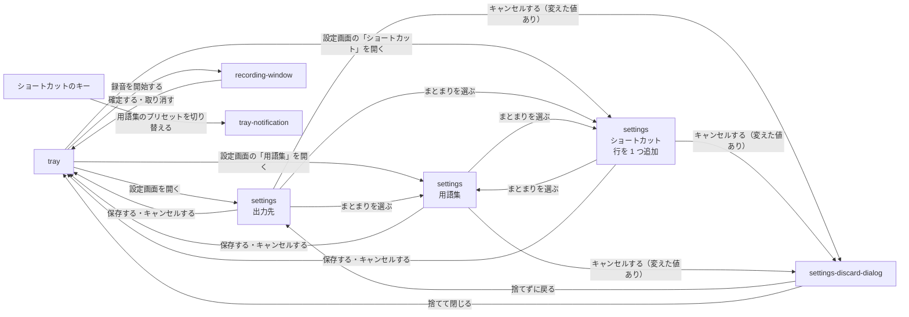

# 常駐アプリ

## 現状

<!-- table: data -->

| 分類 | ページ / ファイル | 概要 | 補足 |
| --- | --- | --- | --- |
| ドキュメント | [docs/scenario/SC-6.yaml](https://github.com/shuhei1101/voice-paste/blob/78b689875265c576254553091c5c859591937efa/docs/scenario/SC-6.yaml) | 設定を変える | ショートカットを登録して切り替えるシナリオと、トレイから「ショートカット」を開いて行が 1 つ追加された状態で開くシナリオを追加する |
| ドキュメント | [docs/scenario/SC-2.yaml](https://github.com/shuhei1101/voice-paste/blob/78b689875265c576254553091c5c859591937efa/docs/scenario/SC-2.yaml) | トレイから操作する | 設定画面の「用語集」「ショートカット」を開くシナリオと、裏に隠れた・最小化した設定画面を最前面に戻すシナリオを追加する |
| ドキュメント | [docs/scenario/SC-8.yaml](https://github.com/shuhei1101/voice-paste/blob/78b689875265c576254553091c5c859591937efa/docs/scenario/SC-8.yaml) | 録音する | 設定画面を開いたまま録音するシナリオと、ショートカットで用語集のプリセットを切り替えるシナリオを追加する |
| ドキュメント | [docs/screen/SCR-9.py.yaml](https://github.com/shuhei1101/voice-paste/blob/78b689875265c576254553091c5c859591937efa/docs/screen/SCR-9.py.yaml) | 設定画面 | 窓の「開いている間はホットキーを受け付けず」を修正し、ショートカットのまとまり・行・行の追加ボタンを追加する。補足「まとまりと欄」の並びを修正する |
| ドキュメント | [docs/screen/SCR-1.py.yaml](https://github.com/shuhei1101/voice-paste/blob/78b689875265c576254553091c5c859591937efa/docs/screen/SCR-1.py.yaml) | トレイ | 設定画面の「用語集」「ショートカット」を開くメニューの項目を追加する。「設定…」の前面に出す動きに最小化からの復帰を加える |
| ドキュメント | [docs/config/CFG-1.yaml](https://github.com/shuhei1101/voice-paste/blob/78b689875265c576254553091c5c859591937efa/docs/config/CFG-1.yaml) | 常駐アプリの設定 | 用語集のプリセットを切り替えるショートカットのキーを追加する |
| ドキュメント | [docs/module/MOD-30.py.yaml](https://github.com/shuhei1101/voice-paste/blob/78b689875265c576254553091c5c859591937efa/docs/module/MOD-30.py.yaml) | controller.py | `open_settings` に開くまとまりの指定と最小化からの復帰を加え、ホットキーの受付の停止を解除する |
| ドキュメント | [docs/module/MOD-31.py.yaml](https://github.com/shuhei1101/voice-paste/blob/78b689875265c576254553091c5c859591937efa/docs/module/MOD-31.py.yaml) | tray.py | メニューの項目とシグナルを追加する |
| ドキュメント | [docs/module/MOD-36.py.yaml](https://github.com/shuhei1101/voice-paste/blob/78b689875265c576254553091c5c859591937efa/docs/module/MOD-36.py.yaml) | settings_window.py | まとまりの並び（GROUP_NAMES・FIELD_LAYOUT）と、開くまとまりの指定・行を 1 つ追加して開く入口を追加する |
| ドキュメント | [docs/module/MOD-33.py.yaml](https://github.com/shuhei1101/voice-paste/blob/78b689875265c576254553091c5c859591937efa/docs/module/MOD-33.py.yaml) | hotkey.py | 用語集のプリセットを切り替えるホットキーの登録と、ホットキーの欄が入力待ちの間に押したキーを録音へ伝えない仕組みを追加する |
| ドキュメント | [docs/module/MOD-50.py.yaml](https://github.com/shuhei1101/voice-paste/blob/78b689875265c576254553091c5c859591937efa/docs/module/MOD-50.py.yaml) | shared/settings.py | ショートカットの設定のモデルと、ほかのホットキーと重ならないことの確認を追加する |
| ドキュメント | [docs/mock/pages/settings/173/b-picked-list/](https://github.com/shuhei1101/voice-paste/blob/78b689875265c576254553091c5c859591937efa/docs/mock/pages/settings/173/b-picked-list/) | 設定画面の今のモック | 採用案は `docs/mock/pages/settings/291/` に作る |
| ドキュメント | [docs/mock/pages/tray/](https://github.com/shuhei1101/voice-paste/blob/78b689875265c576254553091c5c859591937efa/docs/mock/pages/tray/) | トレイのモック | メニューの項目を追加した案を作る |
| 実装 | [src/voice_paste/ui/controller.py](https://github.com/shuhei1101/voice-paste/blob/78b689875265c576254553091c5c859591937efa/src/voice_paste/ui/controller.py) | 設定画面を開くときに `suspend_hotkeys` を呼び、既にあるときは `raise_`・`activateWindow` だけを呼ぶ | 最小化した窓はこの 2 つでは戻らない |
| 実装 | [src/voice_paste/ui/tray.py](https://github.com/shuhei1101/voice-paste/blob/78b689875265c576254553091c5c859591937efa/src/voice_paste/ui/tray.py) | 「設定…」は録音から届けるまでの間は押せない | |
| 実装 | [src/voice_paste/ui/windows/settings_window.py](https://github.com/shuhei1101/voice-paste/blob/78b689875265c576254553091c5c859591937efa/src/voice_paste/ui/windows/settings_window.py) | まとまりの並びは出力先が先頭 | |
| 実装 | [src/voice_paste/runtime/hotkey.py](https://github.com/shuhei1101/voice-paste/blob/78b689875265c576254553091c5c859591937efa/src/voice_paste/runtime/hotkey.py) | 設定のホットキーを pynput で受け付ける | |
| 実装 | [src/voice_paste/main.py](https://github.com/shuhei1101/voice-paste/blob/78b689875265c576254553091c5c859591937efa/src/voice_paste/main.py) | `suspend_hotkeys` に `hotkey_listener.stop` を配線する | |
| 実装 | [src/voice_paste/shared/settings.py](https://github.com/shuhei1101/voice-paste/blob/78b689875265c576254553091c5c859591937efa/src/voice_paste/shared/settings.py) | 設定のモデル | |
| 実装 | [config/defaults.yaml](https://github.com/shuhei1101/voice-paste/blob/78b689875265c576254553091c5c859591937efa/config/defaults.yaml) と [settings.sample.yaml](https://github.com/shuhei1101/voice-paste/blob/78b689875265c576254553091c5c859591937efa/settings.sample.yaml) | 設定の既定値と見本 | ショートカットのキーの既定値（空）と見本を追加する |
| テスト | [tests/integration/ui/test_settings_window.py](https://github.com/shuhei1101/voice-paste/blob/78b689875265c576254553091c5c859591937efa/tests/integration/ui/test_settings_window.py) | 設定画面の結合テスト | ショートカットのまとまりの欄の配置と、行を 1 つ追加して開く動きを検証する |
| テスト | [tests/integration/ui/test_tray.py](https://github.com/shuhei1101/voice-paste/blob/78b689875265c576254553091c5c859591937efa/tests/integration/ui/test_tray.py) | トレイの結合テスト | 追加したメニューの項目を検証する |
| テスト | [tests/unit/voice_paste/ui/test_controller.py](https://github.com/shuhei1101/voice-paste/blob/78b689875265c576254553091c5c859591937efa/tests/unit/voice_paste/ui/test_controller.py) | controller の単体テスト | 設定画面を開いてもホットキーの受付を止めないこと・最小化からの復帰 |

<!-- /table -->

## 変更方針

<!-- table: data -->

| 対象 | 方針 | 補足 |
| --- | --- | --- |
| 設定画面と録音の同時使用 | 設定画面を開いてもホットキーの受付を止めない。ホットキーの欄が入力待ちの間だけ、押したキーを録音・確定・取り消し・切り替えに伝えない | 保存したホットキーは、閉じるのを待たずに保存の時点で受付を登録し直す |
| 録音中の設定画面 | 録音から届けるまでの間も、トレイから設定画面を開ける | `未確定`（[要件](./要件.md)） |
| 既にある設定画面の前面化 | 最小化していれば元の大きさへ戻してから前面に出し、フォーカスを移す | Windows の前面化の制限で出ない場合は、実装で窓の状態を戻す API を適用して確認する |
| ショートカットの設定 | 用語集のプリセットを切り替えるショートカットの一覧のキーを追加する（行 = キーの組み合わせ + 用語集のプリセットの名前）。キーが無い settings.yaml は空の一覧として読み込む | キーはほかのホットキーと重ならないこと。用語集のプリセットの名前を変える・削除すると、指している行も追随する |
| ショートカットの動き | 登録したキーを押すと、補正に使用する用語集のプリセット（`active_glossary_preset`）をそのプリセットへ切り替えて保存する | 切り替えたことの通知の方法（トレイの通知など）は単一ユースケース設計で決める |
| 設定画面の配置 | ショートカットの行と行の追加ボタンを、まとまりの上のほうに配置する | `未確定`（[要件](./要件.md)） |
| トレイのメニュー | 設定画面の「用語集」「ショートカット」を開く項目を追加する。「ショートカット」から開いたときは行を 1 つ追加し、用語集のプリセットの欄に既定の用語集のプリセットを入れる | 項目の名前と位置はモック作成で決める |
| 既定の用語集のプリセット | `active_glossary_preset` のプリセット（キーが無い・名前が一覧に無いときは 1 件目） | 設定の設計書の `active_glossary_preset` と同じ決まり |

<!-- /table -->

### 画面一覧

| 種別 | 画面 | 概要 | アクション | 判定の根拠 | 補足 |
| --- | --- | --- | --- | --- | --- |
| 変更 | `tray` | トレイのアイコンとメニュー | 録音を開始する 録音の画面を表示する 設定画面を開く 設定画面の「用語集」を開く 設定画面の「ショートカット」を開く フォルダを開く 再起動する 終了する | 設定画面のまとまりへ直接移る入口で、どれにも該当しないため別の画面（設定画面）へのナビゲーションにする。メニューの項目は同じ親（設定画面）へ移る項目として「設定…」の隣に並べる | 項目の名前と位置は `未確定`（決める段: モック作成） |
| 変更 | `settings` | 設定画面に「ショートカット」のまとまりを追加する | まとまりを選ぶ ショートカットの行を追加する 行のキーの組み合わせを入れる 行の用語集のプリセットを選ぶ 行を削除する 保存する キャンセルする | 同じ対象（設定）の関連するが別のまとまりのため、既存のまとまりのメニュー（横のメニュー）に 1 項目を追加する。1 行の追加・修正はその場（行の中）で行う | まとまりの位置は `未確定`（要件の論点。決める段: モック作成） |
| 変更 | `tray-notification` | ショートカットで用語集のプリセットを切り替えたことの通知 | - | 利用者の操作（キー）をきっかけにした裏の処理の結果のため、モーダルでなく通知で出す | 通知を出すかは `未確定`（決める段: 単一ユースケース設計） |

`未確定`: トレイのメニューの項目の名前と位置（決める段: モック作成）

| 案 | 内容 | メリット | デメリット |
| --- | --- | --- | --- |
| A | 「設定…」の直下に「用語集の設定…」「ショートカットの設定…」を並べる | 設定画面へ移る 3 項目がまとまって見つけやすい | メニューが 2 行長くなる |
| B | 「設定」のサブメニューに「全般…」「用語集…」「ショートカット…」を置く | メニューの長さが変わらない | 今の「設定…」が 1 クリック増える |

推奨: A

利用者は「1 発で」開くことを求めており、サブメニューを挟むと 1 操作増えるため。

`未確定`: ショートカットで切り替えたときにトレイの通知を出すか（決める段: 単一ユースケース設計）

| 案 | 内容 | メリット | デメリット |
| --- | --- | --- | --- |
| A | 切り替えたプリセットの名前をトレイの通知で出す | 押したキーが効いたことと、今のプリセットが分かる | 通知が増える |
| B | 通知を出さず、トレイのアイコンのヒントに今のプリセットを出す | 作業の邪魔をしない | 切り替わったことにすぐ気づけない |

推奨: A

ホットキーは画面を見ずに押すため、効いたかを確認する手段が無いと押し直しや誤った用語集での補正が起きるため。

### 画面遷移

- 設定画面が開いているときにトレイから開くと、新しい窓を作らずに今の窓を最前面に戻し、選んだまとまりへ切り替える（「ショートカット」は行を 1 つ追加する）
- 設定画面を開いたまま、トレイ・ホットキーから `recording-window` を開ける（設定画面は閉じない）
- `settings` の「キャンセルする（変えた値なし）」は確認を挟まずに閉じる（今のまま）
