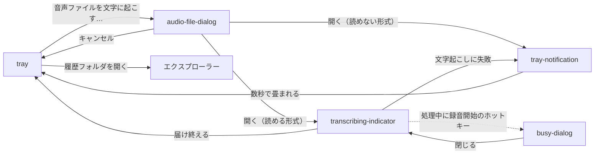

# 常駐アプリ

## 現状

| 分類 | ページ / ファイル | 概要 | 補足 |
| --- | --- | --- | --- |
| ドキュメント | [docs/scenario/SC-2.yaml](https://github.com/shuhei1101/voice-paste/blob/develop/docs/scenario/SC-2.yaml) | トレイから操作する | フォルダを開く操作は設定とログの 2 つ |
| ドキュメント | [docs/scenario/SC-9.yaml](https://github.com/shuhei1101/voice-paste/blob/develop/docs/scenario/SC-9.yaml) | 録音を文字に起こす | 入力は確定した録音だけ |
| ドキュメント | [docs/scenario/SC-7.yaml](https://github.com/shuhei1101/voice-paste/blob/develop/docs/scenario/SC-7.yaml) | 起こした文字を届ける | 出力先の選び方はホットキー・トレイから始めた録音と API から始めた録音で分かれる |
| ドキュメント | [docs/scenario/SC-8.yaml](https://github.com/shuhei1101/voice-paste/blob/develop/docs/scenario/SC-8.yaml) | 録音する | 録音から届けるまでの間の排他 |
| ドキュメント | [docs/scenario/SC-12.yaml](https://github.com/shuhei1101/voice-paste/blob/develop/docs/scenario/SC-12.yaml) | 声で入力した文字を貼り付ける | 実行のみ |
| ドキュメント | [docs/screen/SCR-1.py.yaml](https://github.com/shuhei1101/voice-paste/blob/develop/docs/screen/SCR-1.py.yaml) | トレイ | メニューの項目の並びと押せる条件 |
| ドキュメント | [docs/screen/SCR-7.py.yaml](https://github.com/shuhei1101/voice-paste/blob/develop/docs/screen/SCR-7.py.yaml) | 文字起こし中の表示 | 音声ファイルの文字起こしでも出すかを決める |
| ドキュメント | [docs/module/MOD-31.py.yaml](https://github.com/shuhei1101/voice-paste/blob/develop/docs/module/MOD-31.py.yaml) | tray.py | メニューの項目とフォルダを開く処理 |
| ドキュメント | [docs/module/MOD-30.py.yaml](https://github.com/shuhei1101/voice-paste/blob/develop/docs/module/MOD-30.py.yaml) | controller.py | トレイの操作と録音セッションの配線 |
| ドキュメント | [docs/module/MOD-24.py.yaml](https://github.com/shuhei1101/voice-paste/blob/develop/docs/module/MOD-24.py.yaml) | session/service.py | 録音セッションの入口と排他 |
| ドキュメント | [docs/module/MOD-9.py.yaml](https://github.com/shuhei1101/voice-paste/blob/develop/docs/module/MOD-9.py.yaml) | history/service.py | 履歴の配置先 |
| 実装 | [src/voice_paste/ui/tray.py](https://github.com/shuhei1101/voice-paste/blob/develop/src/voice_paste/ui/tray.py) | トレイのアイコン・メニュー・通知 | 履歴のフォルダを開く項目と音声ファイルを選ぶ項目が無い |
| 実装 | [src/voice_paste/ui/controller.py](https://github.com/shuhei1101/voice-paste/blob/develop/src/voice_paste/ui/controller.py) | 通知を受けて画面を切り替える | - |
| 実装 | [src/voice_paste/features/session/service.py](https://github.com/shuhei1101/voice-paste/blob/develop/src/voice_paste/features/session/service.py) | 録音セッションの管理 | `start` は録音を始める入口だけで、音声ファイルから始める入口が無い |
| 実装 | [src/voice_paste/main.py](https://github.com/shuhei1101/voice-paste/blob/develop/src/voice_paste/main.py) | 起動と配線 | トレイへ履歴の配置先を渡す |
| テスト | [tests/integration/ui/test_tray.py](https://github.com/shuhei1101/voice-paste/blob/develop/tests/integration/ui/test_tray.py) | トレイの結合テスト | 追加する項目の操作を足す |

## 変更方針

| 対象 | 方針 | 補足 |
| --- | --- | --- |
| トレイのメニュー | 「録音の画面を表示」の下に「音声ファイルを文字に起こす…」、「ログフォルダを開く」の下に「履歴フォルダを開く」を追加する | モック作成で決定 |
| 履歴のフォルダを開く | 履歴の配置先を起動のときにトレイへ渡し、無ければ作ってからエクスプローラー（Linux は既定のファイルマネージャー）で開く | ログフォルダを開く処理と同じ |
| 音声ファイルの選択 | ファイルを選ぶダイアログで 1 つ選ばせ、取り消したら何もせず待機中のまま | 選べる形式は PyAV で音声のストリームを読める形式（外の端末の画面と同じ）。ダイアログは履歴のフォルダを最初に開く |
| 録音セッション | 録音の代わりに選んだ音声ファイルを入力にする入口を足し、確定した後の文字起こし・補正・届ける流れを録音と共有する | 指定した音声ファイルと起こした文字は履歴に残さない |
| 排他 | 録音から届けるまでの間は音声ファイルを選ぶ項目を押せなくし、音声ファイルの処理中は「録音を開始」とホットキー・API の開始を断る | 既存の `SessionBusyError` と同じ扱い |
| 届ける | ホットキー・トレイから始めた録音と同じ出力先の選び方で届け、文字起こし中の表示を出す | - |
| エラー表示 | 読めない音声ファイルは文字起こしの失敗と同じトレイの通知で知らせる | - |

### 画面一覧

| 種別 | 画面 | 概要 | アクション | 判定の根拠 | 補足 |
| --- | --- | --- | --- | --- | --- |
| 変更 | `tray`（トレイ） | 常駐アプリの入口のメニュー | 音声ファイルを文字に起こす… 履歴フォルダを開く | 既存のメニューの項目を足すだけで、新しい画面は要らない。録音を始める操作と並ぶため「録音の画面を表示」の下、フォルダを開く操作は「ログフォルダを開く」の下に置く | 項目名は「音声ファイルを文字に起こす…」「履歴フォルダを開く」（モック作成で決定） |
| 新規 | `audio-file-dialog`（音声ファイルを選ぶダイアログ） | 文字に起こす音声ファイルを 1 つ選ぶ OS 標準のファイルを開くダイアログ | 開く キャンセル | 続けるのに必須の入力のため、モーダル（『操作の配置先』の 1 つ目の判定）。独自の画面を作らず OS 標準のダイアログを使う | 絞り込みは PyAV で読める形式の拡張子を並べた音声ファイルと、全てのファイルの 2 つ |
| 変更 | `transcribing-indicator`（文字起こし中の表示） | 確定から届けるまで出る小さな表示 | 出力先を切り替える（既存） | 録音の文字起こしと同じ進み具合と出力先の切り替えを見せるため、既存の表示を流用する | 指定した音声ファイルの名前を 1 行で出し、長い名前は末尾を省略する（モック作成で決定） |
| 変更 | `tray-notification`（トレイの通知） | 裏の処理の失敗の通知 | - | 読めない形式は、文字起こしの失敗と同じく裏の処理の結果として通知で出す（『モーダル』の「裏で動く処理の通知は通知で出す」） | 読めない形式の文言を足す。音声ファイルの文字起こしに失敗したときの文言も足す（今の「録音は履歴に残っています。」に代えて、指定したファイルが元の場所に残っていることを添える）。履歴には残さないため、「録音は履歴に残っています。」は出さない。文言の言い回しは画面設計で決める |
| 変更 | `busy-dialog`（処理中のダイアログ） | 録音を始められない理由を出すダイアログ | 閉じる（既存） | 既存のダイアログの理由に「音声ファイルの文字起こしの処理中」を足すだけ | - |

### 画面遷移

## 設計書の確定コミット

| 工程 | 範囲 | 補足 |
| --- | --- | --- |
| 複合ユースケース設計 | `36fb3d3..518d496` | - |
| 複合ユースケース設計 | `518d496..5cb9c62` | 提案の反映（処理中のホットキーのシナリオ）とレビューの指摘の修正 |
| 単一ユースケース設計 | `b2aa565..8ac2ce5` | SC-14 の失敗シナリオの前提を SC-9 と揃えた修正を含む |
| 単一ユースケース設計 | `8ac2ce5..f442f4e` | レビューの指摘の修正（エンジンごとの指定した音声ファイルの扱い） |
| インターフェース定義設計 | `fc29f44..53ab2c0` | IF-12 の制約の追従 |
| 画面設計 | `f3abdb5..eb4f5c8` | - |
| 画面設計 | `1e0ef73..3a37a2e` | 提案の反映（SCR-2・SCR-3・SCR-7 の mock を戻す） |
| モジュール構成設計 | `3a37a2e..2f8669b` | SCR-2 の通知の種類名（audio_file_transcription_failed）の追従を含む |
| モジュール構成設計 | `98eaf54..e54a3e6` | レビューの指摘の修正（確定後の流れへの寄せ・空の結果・届けられないときの通知） |
| モジュール構成設計 | `e54a3e6..39fb6b4` | 実装で分かった欠けの修正（build_ui_deps に通知の関数を引数で渡す） |

## テスト結果

### ドキュメント修正

使い方のページ（`docs/guide/録音して貼り付ける.md`・`docs/guide/起動と設定.md`）の修正だけで、規約『V字モデル』の対応表で関係する単体・結合テストは無い。単体・結合テストは、続く単体テスト作成・実装・結合テスト作成の工程で実行する。

### 単体テスト

| 対象 | 結果 | ログ |
| --- | --- | --- |
| 単体テスト作成の Red（`a25f1ef`） | fail 15 件（全て実装が無いことによる） | [ログ](./テスト結果/20261120194801_a25f1ef_単体テスト.log) |
| 実装の後の全件（`401946a`・ランナー） | 953 passed・57 skipped | [ログ](./テスト結果/20261120200615_401946a_単体テスト.log) |
| lint（`401946a`） | 違反なし | [ログ](./テスト結果/20261120200615_401946a_lint.log) |
| 実装の後に直したテスト（`401946a`） | `tests/unit/voice_paste/features/session/helpers.py`・`tests/unit/voice_paste/ui/helpers.py`（Red を回すための組み立ての一時の分岐を消し、常に渡す）・`tests/unit/voice_paste/ui/test_controller.py`（ダイアログの絞り込み `*.wav` と `(*)` も確かめる）。理由は[単体テストの合格報告の提案](https://github.com/shuhei1101/voice-paste/pull/339#discussion_r4641535244)の反映 | 上の全件のログに含む |

### 結合テストの実行範囲

結合テストの層 TL-2 は `excluded_paths`・`full_run_paths`・`folder_map` を持たないため、MCP `judge_integration_scope` の判定は全てのファイルが R7（関係すると分かった結合テスト）になった。
変更したファイルを参照する結合テストを grep で調べ、次の表にした。全件にした行は無い。

<!-- table: {"kind": "data"} -->

| 変更したファイル | 結果 | 実行する結合テスト | 結合テストが無い入口 |
| --- | --- | --- | --- |
| `docs/guide/files.yml` | R7（どの結合テストも参照しない） | なし | - |
| `docs/guide/index.yaml` | R7（どの結合テストも参照しない） | なし | - |
| `docs/guide/使い方.md` | R7（どの結合テストも参照しない） | なし | - |
| `docs/guide/起動と設定.md` | R7（どの結合テストも参照しない） | なし | - |
| `docs/guide/録音して貼り付ける.md` | R7（どの結合テストも参照しない） | なし | - |
| `docs/interface/IF-12.py.yaml` | R7（どの結合テストも参照しない） | なし | - |
| `docs/mock/files.yml` | R7（どの結合テストも参照しない） | なし | - |
| `docs/mock/pages/busy-dialog/339/a-file-busy/index.html` | R7（どの結合テストも参照しない） | なし | - |
| `docs/mock/pages/busy-dialog/339/index.md` | R7（どの結合テストも参照しない） | なし | - |
| `docs/mock/pages/busy-dialog/index.md` | R7（どの結合テストも参照しない） | なし | - |
| `docs/mock/pages/transcribing-indicator/339/a-file-name/index.html` | R7（どの結合テストも参照しない） | なし | - |
| `docs/mock/pages/transcribing-indicator/339/index.md` | R7（どの結合テストも参照しない） | なし | - |
| `docs/mock/pages/transcribing-indicator/index.md` | R7（どの結合テストも参照しない） | なし | - |
| `docs/mock/pages/tray-notification/339/a-file-failures/index.html` | R7（どの結合テストも参照しない） | なし | - |
| `docs/mock/pages/tray-notification/339/index.md` | R7（どの結合テストも参照しない） | なし | - |
| `docs/mock/pages/tray-notification/index.md` | R7（どの結合テストも参照しない） | なし | - |
| `docs/mock/pages/tray/339/a-file-items/index.html` | R7（どの結合テストも参照しない） | なし | - |
| `docs/mock/pages/tray/339/index.md` | R7（どの結合テストも参照しない） | なし | - |
| `docs/mock/pages/tray/index.md` | R7（どの結合テストも参照しない） | なし | - |
| `docs/mock/refs/339/assets/style.css` | R7（どの結合テストも参照しない） | なし | - |
| `docs/mock/refs/339/index.md` | R7（どの結合テストも参照しない） | なし | - |
| `docs/mock/refs/index.md` | R7（どの結合テストも参照しない） | なし | - |
| `docs/module/MOD-22.py.yaml` | R7（どの結合テストも参照しない） | なし | - |
| `docs/module/MOD-24.py.yaml` | R7（どの結合テストも参照しない） | なし | - |
| `docs/module/MOD-30.py.yaml` | R7（どの結合テストも参照しない） | なし | - |
| `docs/module/MOD-31.py.yaml` | R7（どの結合テストも参照しない） | なし | - |
| `docs/module/MOD-32.py.yaml` | R7（どの結合テストも参照しない） | なし | - |
| `docs/module/MOD-35.py.yaml` | R7（どの結合テストも参照しない） | なし | - |
| `docs/module/MOD-45.py.yaml` | R7（どの結合テストも参照しない） | なし | - |
| `docs/module/MOD-48.py.yaml` | R7（どの結合テストも参照しない） | なし | - |
| `docs/module/MOD-84.py.yaml` | R7（どの結合テストも参照しない） | なし | - |
| `docs/pr/339/README.mark.md` | R7（どの結合テストも参照しない） | なし | - |
| `docs/pr/339/タスク一覧.yaml` | R7（どの結合テストも参照しない） | なし | - |
| `docs/pr/339/テスト結果/20261120194801_a25f1ef_単体テスト.log` | R7（どの結合テストも参照しない） | なし | - |
| `docs/pr/339/テスト結果/20261120194819_a25f1ef_lint.log` | R7（どの結合テストも参照しない） | なし | - |
| `docs/pr/339/テスト結果/20261120200615_401946a_lint.log` | R7（どの結合テストも参照しない） | なし | - |
| `docs/pr/339/テスト結果/20261120200615_401946a_単体テスト.log` | R7（どの結合テストも参照しない） | なし | - |
| `docs/pr/339/常駐アプリ.mark.md` | R7（どの結合テストも参照しない） | なし | - |
| `docs/pr/339/確認ログ.yaml` | R7（どの結合テストも参照しない） | なし | - |
| `docs/pr/339/要件.mark.md` | R7（どの結合テストも参照しない） | なし | - |
| `docs/pr/339/要件.yaml` | R7（どの結合テストも参照しない） | なし | - |
| `docs/scenario/README.md` | R7（どの結合テストも参照しない） | なし | - |
| `docs/scenario/SC-14.yaml` | R7（どの結合テストも参照しない） | なし | - |
| `docs/scenario/SC-15.yaml` | R7（どの結合テストも参照しない） | なし | - |
| `docs/scenario/SC-2.yaml` | R7（どの結合テストも参照しない） | なし | - |
| `docs/scenario/SC-7.yaml` | R7（どの結合テストも参照しない） | なし | - |
| `docs/scenario/SC-8.yaml` | R7（どの結合テストも参照しない） | なし | - |
| `docs/scenario/SC-9.yaml` | R7（どの結合テストも参照しない） | なし | - |
| `docs/scenario/index.yaml` | R7（どの結合テストも参照しない） | なし | - |
| `docs/screen/SCR-1.py.yaml` | R7（どの結合テストも参照しない） | なし | - |
| `docs/screen/SCR-2.py.yaml` | R7（どの結合テストも参照しない） | なし | - |
| `docs/screen/SCR-3.py.yaml` | R7（どの結合テストも参照しない） | なし | - |
| `docs/screen/SCR-7.py.yaml` | R7（どの結合テストも参照しない） | なし | - |
| `src/voice_paste/features/session/service.py` | R7（確定後の流れ `_run_after_confirm`・`_finish`） | `tests/integration/test_complete_session.py`（API の確定後の流れ）・`tests/integration/test_deliver_to_output.py`（ホットキー・トレイの届け） | 音声ファイルの開始（`start_audio_file`）は API・画面の結合テストを持たないため、単体テスト（MOD-24）と E2E で確かめる |
| `src/voice_paste/features/session/types.py` | R7（`Session`・`SessionDeps`） | `tests/integration/test_complete_session.py`（API の確定後の流れ）・`tests/integration/test_deliver_to_output.py`（ホットキー・トレイの届け） | - |
| `src/voice_paste/main.py` | R7（どの結合テストも import しない） | なし | `start_audio_file_session`・`build_ui_deps` の配線は単体テスト（MOD-84）で確かめる |
| `src/voice_paste/shared/types.py` | R7（`Entry`） | `tests/integration/test_complete_session.py`（API の確定後の流れ）・`tests/integration/test_deliver_to_output.py`（ホットキー・トレイの届け） | - |
| `src/voice_paste/ui/bridge.py` | R7（通知の種類） | `tests/integration/ui/test_tray_notification.py` | - |
| `src/voice_paste/ui/controller.py` | R7（通知の振り分け） | `tests/integration/ui/test_tray.py`・`tests/integration/ui/test_tray_notification.py`・`tests/integration/ui/test_busy_dialog.py`・`tests/integration/ui/test_transcribing_indicator.py` | - |
| `src/voice_paste/ui/tray.py` | R7（メニューの項目・通知・`Tray(history_dir)`） | `tests/integration/ui/test_tray.py`・`tests/integration/ui/test_tray_notification.py`（SCR-1・SCR-2 の `test_file`。結合テスト作成で追加する） | - |
| `src/voice_paste/ui/windows/busy_dialog.py` | R7 | `tests/integration/ui/test_busy_dialog.py`（SCR-3 の `test_file`。結合テスト作成で追加する） | - |
| `src/voice_paste/ui/windows/transcribing_indicator.py` | R7 | `tests/integration/ui/test_transcribing_indicator.py`（SCR-7 の `test_file`。結合テスト作成で追加する） | - |
| `tests/integration/helpers.py` | R7（`build_stack`・`build_output_stack` の `SessionDeps`） | `tests/integration/test_complete_session.py`（API の確定後の流れ）・`tests/integration/test_deliver_to_output.py`（ホットキー・トレイの届け） | - |
| `tests/integration/ui/helpers.py` | R7（`build_ui` のトレイの組み立て） | `tests/integration/ui/test_tray.py`・`tests/integration/ui/test_tray_notification.py`・`tests/integration/ui/test_busy_dialog.py`・`tests/integration/ui/test_transcribing_indicator.py` | - |
| `tests/support/light_session.py` | R7（非機能要件テストだけが使用する） | なし（TL-3 は GPU・`--run-e2e` が要り、タグを打つ前の全件で回す） | - |
| `tests/unit/voice_paste/features/session/helpers.py` | R7（単体テスト） | なし | - |
| `tests/unit/voice_paste/features/session/test_service.py` | R7（単体テスト） | なし | - |
| `tests/unit/voice_paste/test_main.py` | R7（単体テスト） | なし | - |
| `tests/unit/voice_paste/ui/helpers.py` | R7（単体テスト） | なし | - |
| `tests/unit/voice_paste/ui/test_controller.py` | R7（単体テスト） | なし | - |

<!-- /table -->
