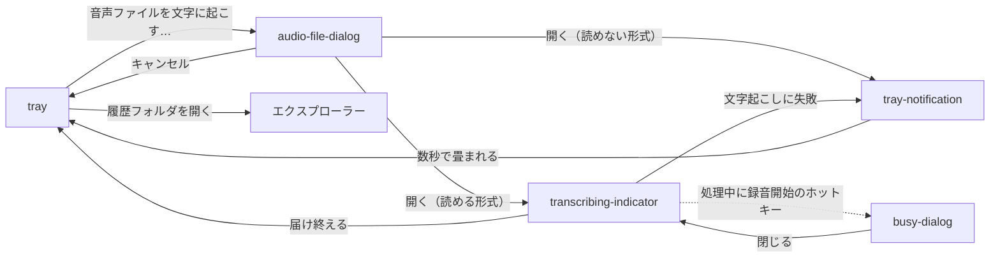

# 常駐アプリ

## 現状

| 分類 | ページ / ファイル | 概要 | 補足 |
| --- | --- | --- | --- |
| ドキュメント | [docs/scenario/SC-2.yaml](https://github.com/shuhei1101/voice-paste/blob/develop/docs/scenario/SC-2.yaml) | トレイから操作する | フォルダを開く操作は設定とログの 2 つ |
| ドキュメント | [docs/scenario/SC-9.yaml](https://github.com/shuhei1101/voice-paste/blob/develop/docs/scenario/SC-9.yaml) | 録音を文字に起こす | 入力は確定した録音だけ |
| ドキュメント | [docs/scenario/SC-7.yaml](https://github.com/shuhei1101/voice-paste/blob/develop/docs/scenario/SC-7.yaml) | 起こした文字を届ける | 出力先の選び方はホットキー・トレイから始めた録音と API から始めた録音で分かれる |
| ドキュメント | [docs/scenario/SC-8.yaml](https://github.com/shuhei1101/voice-paste/blob/develop/docs/scenario/SC-8.yaml) | 録音する | 録音から届けるまでの間の排他 |
| ドキュメント | [docs/scenario/SC-12.yaml](https://github.com/shuhei1101/voice-paste/blob/develop/docs/scenario/SC-12.yaml) | 声で入力した文字を貼り付ける | 実行のみ |
| ドキュメント | [docs/screen/SCR-1.py.yaml](https://github.com/shuhei1101/voice-paste/blob/develop/docs/screen/SCR-1.py.yaml) | トレイ | メニューの項目の並びと押せる条件 |
| ドキュメント | [docs/screen/SCR-7.py.yaml](https://github.com/shuhei1101/voice-paste/blob/develop/docs/screen/SCR-7.py.yaml) | 文字起こし中の表示 | 音声ファイルの文字起こしでも出すかを決める |
| ドキュメント | [docs/module/MOD-31.py.yaml](https://github.com/shuhei1101/voice-paste/blob/develop/docs/module/MOD-31.py.yaml) | tray.py | メニューの項目とフォルダを開く処理 |
| ドキュメント | [docs/module/MOD-30.py.yaml](https://github.com/shuhei1101/voice-paste/blob/develop/docs/module/MOD-30.py.yaml) | controller.py | トレイの操作と録音セッションの配線 |
| ドキュメント | [docs/module/MOD-24.py.yaml](https://github.com/shuhei1101/voice-paste/blob/develop/docs/module/MOD-24.py.yaml) | session/service.py | 録音セッションの入口と排他 |
| ドキュメント | [docs/module/MOD-9.py.yaml](https://github.com/shuhei1101/voice-paste/blob/develop/docs/module/MOD-9.py.yaml) | history/service.py | 履歴の配置先 |
| 実装 | [src/voice_paste/ui/tray.py](https://github.com/shuhei1101/voice-paste/blob/develop/src/voice_paste/ui/tray.py) | トレイのアイコン・メニュー・通知 | 履歴のフォルダを開く項目と音声ファイルを選ぶ項目が無い |
| 実装 | [src/voice_paste/ui/controller.py](https://github.com/shuhei1101/voice-paste/blob/develop/src/voice_paste/ui/controller.py) | 通知を受けて画面を切り替える | - |
| 実装 | [src/voice_paste/features/session/service.py](https://github.com/shuhei1101/voice-paste/blob/develop/src/voice_paste/features/session/service.py) | 録音セッションの管理 | `start` は録音を始める入口だけで、音声ファイルから始める入口が無い |
| 実装 | [src/voice_paste/main.py](https://github.com/shuhei1101/voice-paste/blob/develop/src/voice_paste/main.py) | 起動と配線 | トレイへ履歴の配置先を渡す |
| テスト | [tests/integration/ui/test_tray.py](https://github.com/shuhei1101/voice-paste/blob/develop/tests/integration/ui/test_tray.py) | トレイの結合テスト | 追加する項目の操作を足す |

## 変更方針

| 対象 | 方針 | 補足 |
| --- | --- | --- |
| トレイのメニュー | 「録音を開始」の下に音声ファイルを選んで文字に起こす項目、「ログフォルダを開く」の並びに履歴のフォルダを開く項目を追加する | 項目名と位置はモック作成で決める |
| 履歴のフォルダを開く | 履歴の配置先を起動のときにトレイへ渡し、無ければ作ってからエクスプローラー（Linux は既定のファイルマネージャー）で開く | ログフォルダを開く処理と同じ |
| 音声ファイルの選択 | ファイルを選ぶダイアログで 1 つ選ばせ、取り消したら何もせず待機中のまま | 選べる形式は要件の `未確定` |
| 録音セッション | 録音の代わりに選んだ音声ファイルを入力にする入口を足し、確定した後の文字起こし・補正・届ける流れを録音と共有する | 履歴に残すかは要件の `未確定` |
| 排他 | 録音から届けるまでの間は音声ファイルを選ぶ項目を押せなくし、音声ファイルの処理中は「録音を開始」とホットキー・API の開始を断る | 既存の `SessionBusyError` と同じ扱い |
| 届ける | ホットキー・トレイから始めた録音と同じ出力先の選び方で届け、文字起こし中の表示を出す | - |
| エラー表示 | 読めない音声ファイルは文字起こしの失敗と同じトレイの通知で知らせる | - |

### 画面一覧

| 種別 | 画面 | 概要 | アクション | 判定の根拠 | 補足 |
| --- | --- | --- | --- | --- | --- |
| 変更 | `tray`（トレイ） | 常駐アプリの入口のメニュー | 音声ファイルを文字に起こす… 履歴フォルダを開く | 既存のメニューの項目を足すだけで、新しい画面は要らない。録音を始める操作と並ぶため「録音の画面を表示」の下、フォルダを開く操作は「ログフォルダを開く」の下に置く | 項目名は `未確定`（決める段: モック作成） |
| 新規 | `audio-file-dialog`（音声ファイルを選ぶダイアログ） | 文字に起こす音声ファイルを 1 つ選ぶ OS 標準のファイルを開くダイアログ | 開く キャンセル | 続けるのに必須の入力のため、モーダル（『操作の配置先』の 1 つ目の判定）。独自の画面を作らず OS 標準のダイアログを使う | 一覧の絞り込みの拡張子は要件の `未確定`（選べる形式）で決まる |
| 変更 | `transcribing-indicator`（文字起こし中の表示） | 確定から届けるまで出る小さな表示 | 出力先を切り替える（既存） | 録音の文字起こしと同じ進み具合と出力先の切り替えを見せるため、既存の表示を流用する | 指定した音声ファイルの名前を出すかは `未確定`（決める段: モック作成） |
| 変更 | `tray-notification`（トレイの通知） | 裏の処理の失敗の通知 | - | 読めない形式は、文字起こしの失敗と同じく裏の処理の結果として通知で出す（『モーダル』の「裏で動く処理の通知は通知で出す」） | 読めない形式の文言を足す |
| 変更 | `busy-dialog`（処理中のダイアログ） | 録音を始められない理由を出すダイアログ | 閉じる（既存） | 既存のダイアログの理由に「音声ファイルの文字起こしの処理中」を足すだけ | - |

`未確定`: トレイのメニューの項目名（決める段: モック作成）

| 案 | 内容 |
| --- | --- |
| A | 「音声ファイルを文字に起こす…」「履歴フォルダを開く」 |
| B | 「ファイルから文字起こし…」「履歴を開く」 |

推奨: A

既存の項目「設定フォルダを開く」「ログフォルダを開く」と語の並びが揃い、「…」でダイアログが開くことも既存の「設定…」と揃う。

`未確定`: 文字起こし中の表示に、指定した音声ファイルの名前を出すか（決める段: モック作成）

| 案 | 内容 |
| --- | --- |
| A | 出さない（録音の文字起こしと同じ表示） |
| B | ファイル名を 1 行で出す（長い名前は末尾を省略する） |

推奨: B

履歴の WAV は日時の名前で並ぶため、起こし直している録音を表示で確かめられる。

### 画面遷移

## 設計書の確定コミット

| 工程 | 範囲 | 補足 |
| --- | --- | --- |
| 複合ユースケース設計 | `36fb3d3..518d496` | - |

## テスト結果

未実施。
